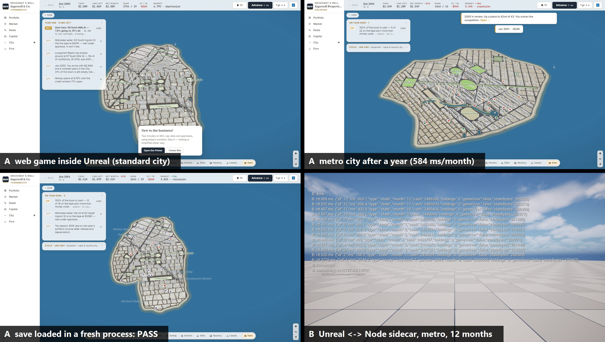
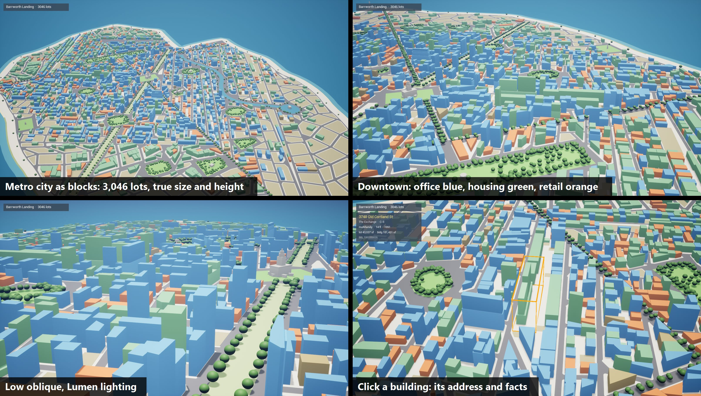
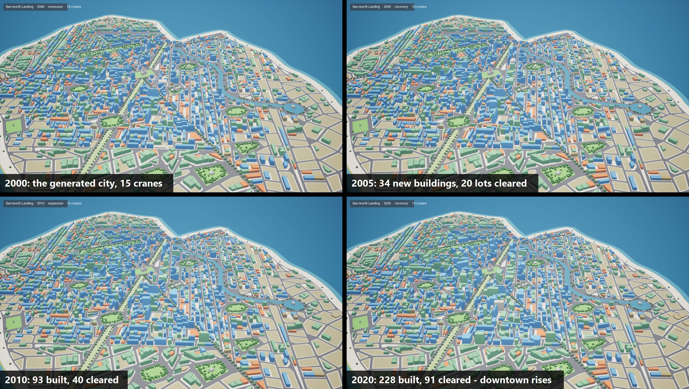
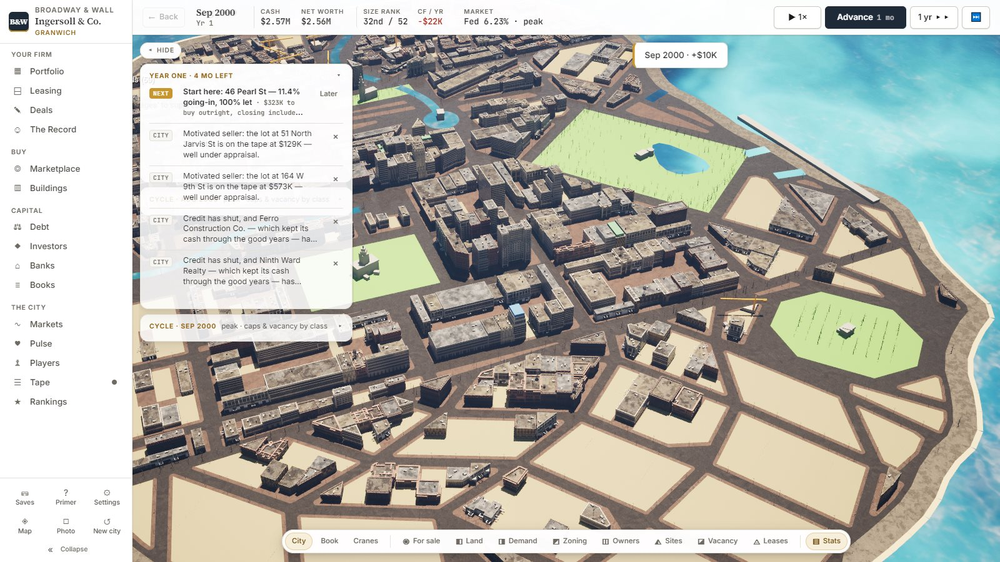
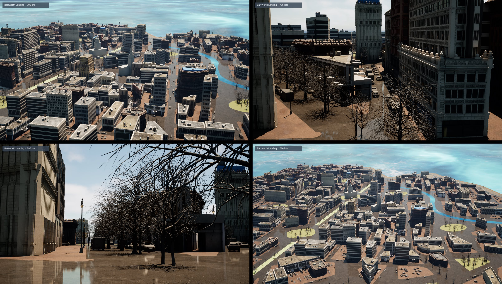

# Broadway & Wall on Unreal Engine 5.8 — the plan

> **Status (2026-10-19, owner's decision):** the game moves to Unreal Engine 5.8.
> The web build (`broadway-and-wall/`, React + MapLibre + Three.js) is
> **frozen**: no new features, no new economy rounds, no new UI. It stays in
> the repo as the reference implementation and as the source of the economy
> engine, which the Unreal game reuses as-is. The goal of the move is
> photoreal graphics, Matrix Awakens / City Sample quality.

Read this file first in any session that works on the Unreal game. Read
`broadway-and-wall/CLAUDE.md` and `broadway-and-wall/HANDOFF.md` before
touching the economy engine.

---

## 1 · What we are moving, measured

| Part | Where | Size | Fate |
|---|---|---|---|
| Economy engine | `broadway-and-wall/src/engine/` | ~73k lines TS | **Keep, unchanged.** Runs beside Unreal. |
| City generator | `broadway-and-wall/src/citygen/` | ~11k lines JS | **Keep.** Makes the parcel table; Unreal draws it. |
| Tests + baseline | `broadway-and-wall/test/`, `BASELINE.json` | 223 files | **Keep.** Still the guard on the economy. |
| Desk UI (panels, docket, charts) | `broadway-and-wall/src/ui/` | ~30k lines React | **Keep at first** (shown inside Unreal), port piece by piece later. |
| 3D map | `broadway-and-wall/src/map/` | ~21k lines Three.js/MapLibre | **Replace** with Unreal. |
| State / workers / saves | `broadway-and-wall/src/state/` | ~3k lines | Adapt: the store talks to Unreal instead of MapLibre. |

The engine is pure functions over a `GameState` (it already runs in a Web
Worker: `src/state/simWorker.ts` takes `town`, `month` and `span` messages).
That is the seam: whatever hosts the engine, Unreal only needs the state.

**The one rule that makes this tractable: do not rewrite the economy in C++.**
Seventy-three thousand lines of tuned, tested simulation would take longer to
port and re-verify than everything else in this plan together, and every
behaviour we measured would be at risk. Unreal is the renderer and the shell;
the TypeScript engine stays the brain.

---

## 2 · Architecture

```
┌──────────────────────────── Unreal Engine 5.8 (C++) ─────────────────────────┐
│  World: City Sample kit + PCG  ←  CityBuilder (C++)  ←  CityState (C++)      │
│  Camera, picking, construction FX, day/night, traffic, crowds               │
│                                                    ▲                        │
│  UI layer: WebBrowser widget (Chromium) running the existing React desks    │
│            ── JS ↔ C++ bridge (BindUObject) ──────────┘                      │
└──────────────────────────────────────────────────────────────────────────────┘
                 ▲ state snapshots / diffs (JSON)   │ player actions
                 │                                  ▼
        Economy engine (TypeScript, unchanged) + city generator
```

Two ways to host the engine. **Phase 0 decides which by experiment**, not by
argument:

- **A. Engine inside the browser widget.** The web app's code, minus the map,
  runs in Unreal's built-in Chromium exactly as it runs today (worker and
  all). It pushes the render state to C++ through the JS bridge. No extra
  process, saves keep working, the desks work on day one. Risk: the Chromium
  version shipped with the UE WebBrowser plugin may lack something the app
  uses (module workers, a JS feature), or be slow on a large city.
- **B. Engine as a Node sidecar.** A small Node process
  (`unreal/sim-server/`) loads the same engine bundle (`test/.engine.mjs` is
  already a self-contained build of it), holds the authoritative `GameState`,
  and talks to Unreal over a local WebSocket: `town`, `month`, `span`, and one
  `action` message that calls any exported engine action (`buyListing`,
  `startDevelopment`, ...) by name. Packaged with Node's single-executable
  build so players need nothing installed. The desks still run in the browser
  widget, as a client of the sidecar.

Default expectation: **A**, falling back to **B** if the spike shows a blocker.
**Decided 2026-10-19: A** (Phase 0 result, §4).
Either way the C++ side is identical: it receives a city and a stream of state.

### The render contract (what Unreal needs from the engine)

Not the whole `GameState` (megabytes, mostly ledgers). A **map view** built in
TypeScript and sent on load and after each month, as a diff where possible:

- **Per parcel** (static, on load): id (BBL), footprint polygon in metres,
  block, district, lot area, zoning envelope.
- **Per parcel** (dynamic): use class, floors, gross sf, year built, condition
  grade, owner (player / which rival / street), vacancy share, under
  construction (start month, delivery month, progress, target floors and
  use), demolished, landmark, listed for sale, distress.
- **City**: month/date, season, the economic phase, demand pockets.
- **Events** for set-pieces: groundbreak, topping out, delivery, demolition,
  foreclosure, black swan.

This contract is written down as a TypeScript type (`unreal/contract.ts`) and a
matching C++ struct, and checked by a test, so the two sides cannot drift.

### Repository layout

```
unreal/
  BroadwayWall/                 the UE 5.8 project: Source/ (C++), Config/, Plugins/
                                — text only in git; Content/ binaries via Git LFS, kept small
  sim-server/                   (only if option B) the Node sidecar
  contract.ts                   the render contract
  tools/                        export, screenshot and check scripts
UE58_PLAN.md                    this file
broadway-and-wall/              frozen web build + the engine and generator we reuse
```

**City Sample is never committed.** It is ~100 GB of Epic content that lives
in `D:\Projects\CitySample` on the build PC. The game project references or
migrates only the assets it uses. A list of which ones goes in
`unreal/ASSETS.md` so the project can be rebuilt on another machine.

---

## 3 · How an AI agent works on this with the owner hands-off

The owner's machine: i9-9900K, 32 GB RAM, RTX 2080 8 GB, Windows. UE 5.8 at
`D:\UE_5.8`, Visual Studio 2026 Community (C++ game, desktop C++, .NET
workloads), Node 24 LTS, Git, Claude Desktop. Projects in `D:\Projects`.

- **Write C++ and Python, never Blueprints.** Blueprints are binary `.uasset`
  files an agent cannot read, diff or review. Gameplay and tools live in
  `Source/` (C++) and editor Python scripts. Blueprints only as thin data
  shells if unavoidable.
- **Drive the editor through the Unreal MCP server** that ships with 5.8 (City
  Sample 5.8 is described as built for "LLMs to build cities using the Unreal
  MCP server"). Fall back to editor Python (`unreal` module) and commandlets.
- **Build headless:** `RunUAT.bat BuildCookRun` / `UnrealBuildTool` from the
  command line; no clicking in Visual Studio.
- **Check its own work:** an automation test or editor script that loads the
  city, flies a fixed set of cameras and saves high-resolution screenshots to
  `unreal/shots/`, so every change can be looked at, and compared with the
  last one. The owner looks at screenshots on the phone, not at the editor.
- **Keep the economy tests green.** Any engine change still goes through
  `pnpm check` in `broadway-and-wall/`.
- **Disk:** keep `C:` free. Set `UE-LocalDataCachePath=D:\UnrealDDC` and the
  Epic launcher's vault cache on `D:`.
- **Session from the phone:** `claude remote-control` (or the Desktop app's
  Code session) in `D:\Projects`; the PC stays awake.

---

## 4 · Phases

Each phase ends in something the owner can see: a screenshot set or a build.

### Phase 0 — Toolchain and spikes
1. Confirm the toolchain builds a blank C++ UE 5.8 project from the command
   line, and that the City Sample opens and compiles shaders.
2. Connect the Unreal MCP server; prove an agent can spawn, move and screenshot
   actors without a human.
3. **Spike A:** load `broadway-and-wall/playable/broadway-and-wall.html` in a
   WebBrowser widget inside UE. Does it start, run a year, save and load? Time
   a month on the metro city.
4. **Spike B:** run `test/.engine.mjs` in Node behind a WebSocket; Unreal
   advances a month and reads the state back.
5. Pick A or B and write the decision here.

**Done when:** a screenshot of the web game running inside an Unreal window,
and a note of which host was chosen and why.

#### Phase 0 result (2026-10-19) — **done. Host: A.**



| | Result |
|---|---|
| Toolchain | Blank C++ project builds headless (`Build.bat`, MSVC 14.51; UE warns it prefers 14.50, builds fine). |
| MCP | Agent spawned, moved and screenshotted an actor, no human (`unreal/tools/mcp-proof.mjs`, [shot](unreal/shots/phase0/mcp-proof.jpg)). |
| A — browser widget | Chromium 128: WebGL2, module workers, IndexedDB all present. Starts, runs a year, saves, and a **fresh process** loads the save (PASS). |
| A — speed, metro (3,084 lots) | city + game in 2.9 s; a month **584 ms** median (413–1,122), UI and 3D map included. Standard city: 367 ms. |
| B — Node sidecar, metro | Unreal ↔ WebSocket works; a month **~470 ms** engine time + ~25 ms transport. |

**Why A.** It works end to end with no extra process, saves and all, and B is
not faster in any way the player would feel (~100 ms a month, which A spends
drawing the UI). B would also mean rewiring the desks to a remote engine and
shipping Node. `unreal/sim-server/` stays as a headless harness.

**What A needs, learned the hard way:**
- **Serve the page over `http://127.0.0.1`, not `file://`.** A `file://` page
  has a null origin: no IndexedDB, so no saves. Ship with a tiny local server or
  a custom scheme handler.
- **Re-bind the JS bridge after every page load.** The real page loads in a new
  renderer process that never got the permanent `BindUObject` binding;
  `window.ue.bridge` was missing until the game mode unbound and re-bound it in
  `OnLoadCompleted` (`unreal/spikes/BWSpike`).
- Serve HTML as `text/html`; anything else is a silent download and the
  browser stays on `about:blank`.

How to re-run: `unreal/README.md`.

### Phase 1 — The city as blocks
- Export the parcel table and footprints from `makeCity` (`unreal/tools/`).
  The generator's units go to centimetres (UE world units), north up, the
  origin at the city centre.
- C++ `CityBuilder` extrudes each parcel to its floors × storey height as plain
  boxes, colours them by use, and lays out streets from the block geometry.
- RTS-style camera (pan, zoom, orbit), plus parcel picking (click → BBL).

**Done when:** the metro city stands in Unreal at the right size, every
building the right height, and clicking one names its address.

#### Phase 1 result (2026-10-19) — **done**, one item open



- `unreal/tools/export-city.mjs` writes `bw-city/1` JSON: parcels, every
  building tier (the web map's own `buildings3d` feed), ground layers, trees,
  labels. Back through the generator's own projection, so metres are its metres.
  Metro, seed 1: 3,046 lots, 3,242 volumes, 2.6 × 1.5 km, 1.7 MB.
- `unreal/BroadwayWall/` (C++ only, no assets): `CityBuilder` extrudes every
  tier from footprint to height, coloured by use, in 17 mesh chunks; ground in
  layers (sea, land, beach, asphalt, sidewalks, parks, water); trees as
  instances. Parse + build: **0.15 s**. Sky, sun and Lumen are spawned in code.
- RTS camera (WASD pan, wheel zoom, right-drag orbit, Q/E rotate). Click picks
  by geometry — the hit point is tested against the footprints, because
  collision cooking reorders triangles and face indices lie.
- `-Shots=<dir>` flies five fixed cameras, picks the building at the centre
  of the last one, saves PNGs and quits: the check an agent runs after a change.

Open: streets are drawn from the generator's pavement polygons rather than
"laid out from the block geometry" — the same streets, but Phase 3 will want
centrelines and widths (`street` / `centerline` features are in the context
layer, not yet exported). The interactive controls were exercised only by the
scripted camera; nobody has driven them by hand yet.

### Phase 2 — Live economy
- Wire the engine host to `CityState`: start a game, advance months, and the
  blocks change as the economy builds, demolishes and repurposes.
- Construction is visible: hoarding, a rising frame, a crane, opening day.
- The React desks show in an overlay, and selecting a parcel in either place
  selects it in both.

**Done when:** a 20-year autoplay in Unreal shows the skyline growing, and the
game is playable end to end with the existing desks.

#### Phase 2 progress (2026-10-19) — first half done



- **The render contract exists.** `broadway-and-wall/src/engine/renderView.ts`
  is one pure function of the state — per lot what stands or is rising
  (floors × `FLOOR_M` 3.55 × progress), owners, listed/distress, merged sites,
  the month's deed events — using the web map's own rules (MapView's skyline
  and parapet effects). C++ mirror: `unreal/BroadwayWall/.../RenderView.h`.
  `test/render-view.mjs` fails if a field exists on one side only, or if the
  view breaks a rule (it caught a frame and a teardown marker drawn on one lot).
- **The 20-year autoplay works.** `-Sim=ws://…` drives the city from the
  sidecar harness: the metro city ran 2000→2020 in 5½ minutes, 228 buildings
  delivered, 91 lots cleared, downtown visibly taller. The C++ side takes the
  same `bw-render/1` JSON whichever host sends it.

#### Phase 2 result (2026-10-20) — **playable end to end**



- **Host A is wired.** `unreal/Play.cmd` (or `-Play`) starts the real game:
  Unreal serves the committed playable from its own HTTP server
  (`/game/…`, real origin, saves work) and overlays it full-window and
  transparent over the 3D city. With `?host=unreal` the page draws no map
  (`src/state/unrealHost.ts`): it sends the city it cuts (`toBwCity`, shared
  with the CLI exporter — byte-identical), each month's `renderView`, and the
  selection; a transparent surface behind the desks forwards pointer and camera
  keys. Unreal answers clicks in 3D with `window.bwUnreal.select`.
- Verified unattended (`-PlayScript=unreal/tools/play-driver.js -PlayShots`):
  menus → a new town (Granwich, 1,012 lots) → Unreal builds it → ten months of
  cranes, deliveries and a clearance arrive as render views.
- Construction: blue plywood hoarding and a tower crane over every frame.

Left: selection both ways has only been driven by the scripted player; the
player's own `BuildingDesign` choices are not yet mapped to kits; assembled
sites use the convex hull of their deeds.

### Phase 3 — Photoreal
- Replace blocks with City Sample buildings: a kit-of-parts chooser by use,
  height, footprint, era (year built), quality tier and condition. Use the
  5.8 building primitives and PCG so a building of any footprint and floor
  count can be made, not only the sample's prebuilt ones.
- Streets, sidewalks, street furniture, traffic and crowds from City Sample's
  systems (Mass), scaled to the city's density.
- Lumen lighting, a sky and weather tied to the game calendar (season, time
  of day), lights in occupied floors and dark windows in vacant ones.
- Water, piers and parks from the generator's layers.

**Done when:** a screenshot set the owner would call "blows your socks off",
running at 1440p with DLSS at a playable frame rate on the RTX 2080.

#### Phase 3 progress (2026-10-20)



Owner's reference images: `unreal/reference/` (pre-war masonry, lit windows,
rooftop plant, parked cars, overcast or low golden sun).

- **Facades from Epic's own grammar** (`FacadeBuilder`): 11 City Sample kits
  (`unreal/ASSETS.md`), bands stacked up each volume, the repeating shafts
  stretched to land on the roof, a corner then wall modules on the kit's grid
  per edge. Per building: a bay rhythm over the modules that best fit, shop
  doors every few bays, the `_decal` weathering layer on every piece. Kit by
  era and use: pre-1945 masonry (NYA, NYG, CHA, CHC, CHG, CHI, NYH), post-war
  to 1975 (CHH, CHF), curtain wall after (SFC, SFE).
- **Ground and props:** City Sample asphalt, world-space sidewalk concrete,
  rooftop bitumen/tile/pebble-dash, sand beaches; bare street trees in grates,
  street lamps every ~25 m, parked cars at the kerbs, vacant lots as surface car
  parks; roofs with stair bulkheads, condensers, exhausts, vents, water tanks.
- **Light, measured:** sun 75,000 lux, warm late afternoon, volumetric clouds;
  sky light from the engine's daylight cubemap at 8,000 nits (real-time capture
  gave no light in -game); exposure clamped EV 13–14.5; Lumen's cached-lighting
  pre-exposure at EV 12 (the default EV 4 clipped bounce at city exposures).
- **Project settings the kits need:** DX12/SM6 (the building master material
  binds 67 textures; SM5 allows 64), Substrate, virtual textures, no static
  lighting.

- **Streets:** double-yellow centres, dashed lane lines on 12 m+ carriageways,
  zebra bars (`markings` in bw-city/1). **Traffic, first cut:** cars drive the
  lane centrelines, right-hand, ~1 per 160 m of lane.
- **Frame rate, measured** (`-Perf`, `unreal/tools/perf-matrix.sh`; metro city,
  361,702 facade pieces, 2560×1440, RTX 2080, editor `-game`): **41 fps**
  median, 39 p95. Half resolution 55; Lumen off 47; VSM off 35 (virtual
  shadows help); blocks only 60; traffic ~1 fps. The game's Graphics setting
  picks the render resolution (high 100%, medium 67%, low 50%, TSR upscale).

Left: Mass crowds and lane-following traffic with intersections (ZoneGraph);
lit windows at night and weather by season; the asphalt reads very wet; DLSS
(an NVIDIA plugin download — the owner approved accepting its licence).

### Phase 4 — Game feel
- Set-pieces for the moments that matter: groundbreak, topping out, the
  delivery ceremony, demolition, a foreclosure sign, a black swan's effect on
  the street.
- Camera modes: a strategy view, a drone flyover, and a street-level walk.
- The player's own buildings: the `BuildingDesign` choices (facade family,
  crown, materials) mapped to real kit choices.
- Sound: street, construction, weather.

#### Phase 4 progress (2026-10-20)

- Camera modes: `1` strategy, `2` drone flyover, `3` street-level walk
  (WASD, right-drag to look) — also from the page in play mode.
- Opening day: banner poles at the corners of a building for the three months
  after delivery; a lender workout puts barricades at the door.
- The player's design: `BuildingDesign.facade` (the web renderer's twelve
  families) picks the nearest City Sample kit.
- Sound: City Sample's traffic wash and urban air crossfade with altitude; a
  jackhammer on the nearest site going up.
- Left: topping-out and demolition set-pieces, the black swan on the street,
  crown/base design choices, weather sound.

#### Phase 5 progress (2026-10-20)

The desks stay in the browser layer (they work, and the plan says port only
where it helps). Native so far: the map HUD — a hover card beside the pointer
(address, use, floors, year, owner) at frame rate, and the selected-lot card.

### Phase 5 — The UI, native
- Port the most-used surfaces to UMG (C++-driven): top bar, docket, the
  property card, the map HUD. The deep desks can stay in the browser layer
  as long as they work well; port them only where it helps.

### Phase 6 — Ship
- Windows packaged build, an installer, saves in the user's folder, graphics
  settings (DLSS, Lumen quality, crowd density), performance pass, a crash
  reporter.

#### Phase 6 progress (2026-10-20)

`unreal/tools/package.ps1` copies the web game into `Data/web` and runs
BuildCookRun (all of `/Game` is cooked — City Sample content is loaded by path,
so the cooker cannot find it by reference; `Data/` stages as loose files).
Editor-only plugins (MCP, toolsets, Python) are allow-listed to the editor.

**Packaged frame rate:** metro city, 2560×1440 native (no upscaling), RTX 2080:
**48 fps median, 45 p95** — the Phase 3 bar ("playable at 1440p") is met
without DLSS.

**A packaged build plays:** `D:\Builds\BroadwayWall\Windows\BroadwayWall.exe`
(8.6 GB) served the web game from `Data/web`, generated a new town and ran the
economy to June 2001 under the scripted player. Graphics settings come from the
game's own Settings page.

Saves: UE 5.8 keeps CEF's IndexedDB under the user's folder
(`%LOCALAPPDATA%\UnrealEngine\BroadwayWall\webcache_*`), so a reinstall keeps
them; a second copy running at once gets its own folder.

Left: an installer; crash reporter wiring; a pass on cook size (all of `/Game`
is cooked).

#### 2026-10-20, second day — the city, the look, the Build desk

- **Generator, plan 12** (citygen.mjs, `CITY_PLAN = 12`; older saves rebuild
  their own plan): a building over six floors needs a 10 m plate and stands
  no taller than 4.5× its narrow side (no pencil towers); shops, offices,
  garages and works take 78-98% of their lot at grade (open ground on built
  lots 38% → 25%); no creeks, canals or mill ponds; a park has its own kerbed
  footway; a park frontage's centre line is in the middle of the real road; a
  boulevard's carriageways get their own centre lines and its blocks a
  footway. `unreal/tools/audit-streets.mjs` maps asphalt no street claims
  (24.5% → 1.7%).
- **Every building wears the web map's family** (toBwCity runs facades.ts
  familyFor; `Data/facade-families.json` maps 111 families to 18 kits, no kit
  over 13%), with its wall tint. Window rows follow the floor count.
- **Look:** months by real solar geometry (afternoon light) and a weather draw
  per month (clear, partly, overcast, rain; wet streets only in rain); a colour
  grade; eight roof finishes; painted cars (needed City Sample's Traffic
  plugin content for the car-paint material); parks laid out with the
  generator's walks, benches and railings on a seasonal lawn
  (`/Game/BW/Materials/M_BW_Grass`); raised kerbs; street furniture; the far
  shore.
- **Selection:** a gold band on the lot line and a rim at each roof level,
  constant on-screen width; hover a thin white band (`M_BW_Highlight`).
- **The Build desk in Unreal:** the model box is a window onto Unreal — the
  scheme is built on its lot and the camera framed into the box. The Design
  tab is the kit picker (engine/renderView.ts `KITS`): 18 kits named for what
  they build, with thumbnails Unreal renders (`-KitThumbs`, served at
  `/game/kits/`), six wall colours, street floor, top and window rhythm
  (`BuildingDesign.kit/kitColour/ground/top/bays` → `look` on the render lot).
- **Play-throughs:** `unreal/tools/play-driver.js` buys the docket's first
  building and plays three years; `unreal/tools/build-driver.js` buys a lot and
  walks the kit picker.
---

## 5 · Risks and how we handle them

| Risk | Handling |
|---|---|
| 8 GB of VRAM is tight for City Sample | Nanite + virtual textures, cut texture pool, DLSS; city size settings; Phase 3 has a frame-rate budget. |
| 32 GB RAM is tight for City Sample in the editor | Work in a smaller sub-level; a 64 GB upgrade is the cheapest fix if it bites. |
| The browser widget's Chromium can't run the app | Option B (Node sidecar) is designed in from Phase 0. |
| The UE project is mostly binary and agents can't read it | C++/Python only; Content kept small; MCP + screenshots for verification. |
| City Sample's buildings are prebuilt, ours vary | 5.8 building primitives + PCG kit-of-parts; a block-level fallback. |
| Economy drift while the shell changes | Engine untouched; `pnpm check` and `BASELINE.json` stay the gate. |
| Repo size | City Sample never committed; Git LFS for our own few assets. |
| Licensing | City Sample content is licensed for use in Unreal Engine projects (Epic's content license and the UE EULA, including its royalty terms if the game is ever sold). Re-check before release. |

---

## 6 · Decisions the owner makes

1. **Which city first:** the generated metro island (default, ~3,000 parcels)
   or Manhattan. Recommendation: the metro island first, Manhattan once the
   pipeline works.
2. **Art direction:** City Sample's contemporary American downtown as-is, or
   an era look (the game starts in the past). Recommendation: as-is first.
3. **Keep the web build playable during the move?** Recommendation: yes,
   frozen, as the reference until the Unreal game reaches Phase 2.

---

## 7 · First message for the session on the PC

> Clone https://github.com/allpro244/CRE-GAME into D:\Projects\CRE-GAME. Read
> UE58_PLAN.md, AGENTS.md, broadway-and-wall/CLAUDE.md. Then start Phase 0:
> check the toolchain (UE 5.8 at D:\UE_5.8, Visual Studio, Node, Git), set
> UE-LocalDataCachePath to D:\UnrealDDC, connect the Unreal MCP server, and
> run spikes A and B. Read §8 (handoff) first. Report back with screenshots
> and a recommendation before building anything else.

---

## 8 · Handoff from the cloud session (2026-10-19)

Everything a new session needs that is not in the code. Read it once.

### The owner's standing rules (apply to all work, web or Unreal)

- **Realism over everything.** The economy decides outcomes; do not tune
  results by hand. When a number looks wrong, find the mechanism.
- **Merge to main when a piece of work is done**, and send the latest playable
  (`broadway-and-wall/playable/broadway-and-wall.html`) to the owner. For the
  Unreal game, the equivalent is screenshots or a packaged build.
- **At most 4 concurrent heavy processes** on a machine (tests, sims, builds).
- **Economy changes regenerate `broadway-and-wall/BASELINE.json`** and run the
  full suite (`pnpm check` plus the long tests) before merging. Never edit
  `src/` in a worktree while its suite is running: the tests assert a fresh
  engine bundle and every later test fails as "STALE".
- **Commit trailers** end with `Co-Authored-By:` and `Claude-Session:` lines;
  PR bodies end with the "Generated with Claude Code" line. No model names in
  commits or PRs.
- **Off the table unless the owner raises it:** zoning/entitlements work, a
  telework era, removing the 0.05% loan-rate floor, a "today's dollars"
  display. **On hold:** the Pruitt fix, swans, spreading big-firm seizures over
  years.
- **UI:** the owner finds the current UI cluttered with explanatory prose ("AI
  slop"). Numbers and short labels first; explanations only on hover; at most
  one hint per screen, and only when something blocks the player. Build the
  Unreal UI to this from the start; a full revamp is planned.
- **Rates on screen:** the top bar shows one rate, the **10-year Treasury**
  (`econ.indexRate`: fixed loans, mezz, prepayment and cap rates price off
  it). Floating loans show **SOFR + spread** on their own line (the short
  index, `econ.shortIndex`). The Fed rate stays in the background; it alerts
  only for a new chair or a massive move.
- The owner works from a phone a lot: keep messages short, lead with what they
  need to do or decide.

### State of the web build (frozen, but these are open)

- **Last merges:** #396 rival lot assembly, #397 this plan, #398 free
  listings + deferred leasing commissions + flipped demand map +
  `rivalDealTerms` on by default, #399 Fed alerts only for a new chair or a
  massive move + property card shows sf let.
- **Not yet verified on main:** the full suite and a `BASELINE.json`
  regeneration were skipped on #398 and #399 at the owner's request. Run them.
- **`test/buybox.mjs` fails since #398.** Cause found: with `rivalDealTerms`
  on by default, seed 31337 sees no broker first look in 240 months (month 114
  with it off). Fix the test by pinning `{ rivalDealTerms: false }` in its
  `newGame` setup, and separately check across seeds whether first looks have
  become too rare under the new default — that would be a gameplay problem.
- **`test/deed-goes.mjs` fails on main** ("Calloway & Reed now owns the
  deed — no rival owner"); it predates all of the above.
- **Development raise rework — proposed, waiting on the owner.** Playtest
  (30 seeds, $1M start): 0 of 19 raises filled, 9 closed small at exactly 3
  months, 10 failed and lost their counsel. Proposal: "Commit to build" starts
  pre-development (design/permits, like the rivals' `PLAN_LEAD_M`) and the
  raise together, ground breaks when both are done; the player can close with
  what is circled and cover the rest, top up, extend once or pull; investor
  pace shown up front from reputation, the deal's return and the pool, not a
  monthly dice roll; optionally LP capital calls during construction. Do not
  build it until the owner says so.

### The owner's PC, as set up today

- Windows 10, i9-9900K, 32 GB RAM, RTX 2080 8 GB. `C:` is nearly full — keep
  everything on `D:`.
- Unreal Engine 5.8 at `D:\UE_5.8`. The engine is **not registered with
  Windows**: double-clicking a `.uproject` said "No Unreal Engine installations
  found". Open projects with
  `"D:\UE_5.8\Engine\Binaries\Win64\UnrealEditor.exe" "<project>.uproject"`
  or register it with `UnrealVersionSelector.exe` in the same folder.
- City Sample at `D:\Projects\CitySample`, converted in place to 5.8. Project
  files were generated by hand with
  `D:\UE_5.8\Engine\Build\BatchFiles\Build.bat -projectfiles -project=... -game -rocket -progress`
  after the editor's own attempt failed. First open was compiling shaders at
  handoff.
- Visual Studio Community 2026 at `D:\Program Files` (C++ game, desktop C++,
  .NET workloads). MSVC 14.51.36260 is the only toolchain; UE 5.8 warns it is
  newer than its preferred 14.50.35717. If C++ builds misbehave, install the
  14.50 toolset from the VS Installer's Individual components.
- Epic launcher's Fab cache: `D:\EpicVaultCache\VaultCache` (holds a second
  ~96 GB copy of City Sample; safe to clear if space is needed).
- `UE-LocalDataCachePath=D:\UnrealDDC` is set (user scope, checked
  2026-10-19), but processes started before it was set — the Epic launcher,
  the Claude app — do not see it, so editors they start put the DDC and Zen's
  store on `C:` (`%LOCALAPPDATA%\UnrealEngine\Common`, ~1 GB so far). Launch
  through `unreal/tools/ue.ps1`, which sets it (and `UE-ZenDataPath`) fresh;
  a sign-out or reboot fixes it for everything.
- City Sample's MCP server is set to start with the editor on port 8000
  (`Saved/Config/WindowsEditor/EditorPerProjectUserSettings.ini`); the repo's
  `.mcp.json` points Claude Code at it. The spike project uses 8001.
- Node 24 LTS, Git, Claude Desktop installed. `pnpm` comes through
  `corepack pnpm`. The owner controls sessions from the phone via Remote
  Control.
