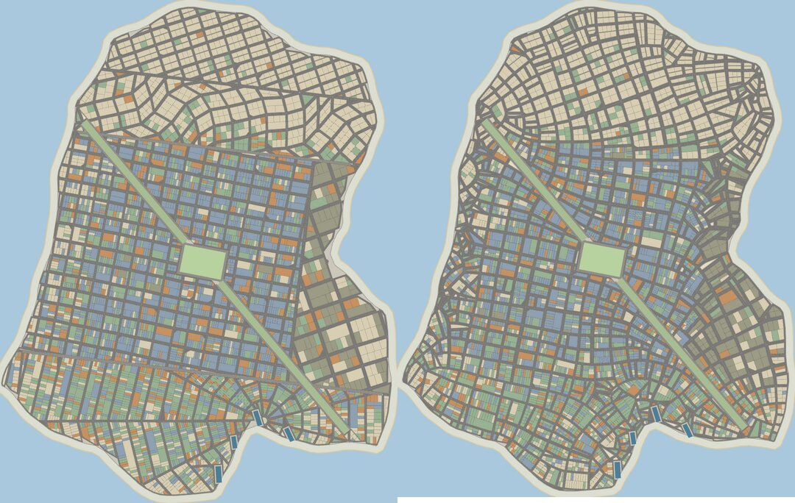
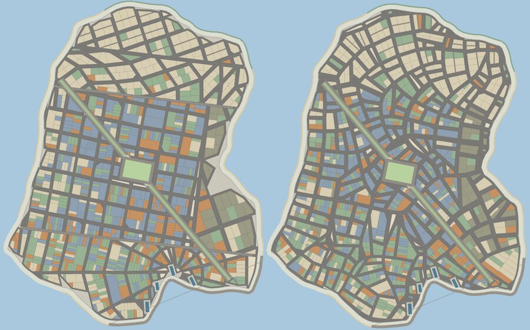
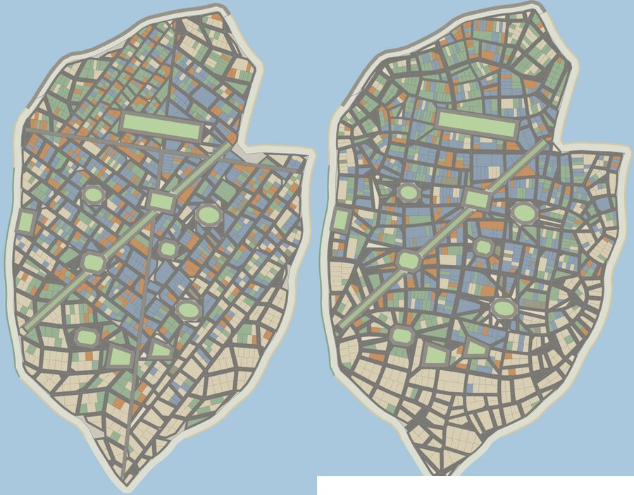
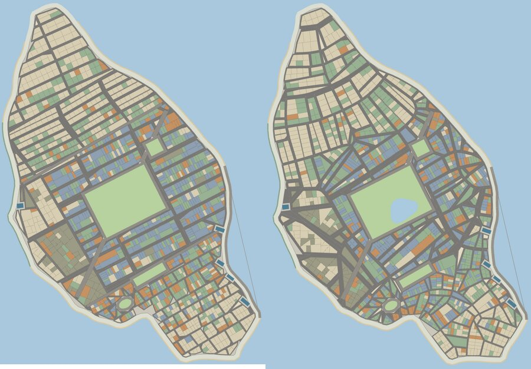
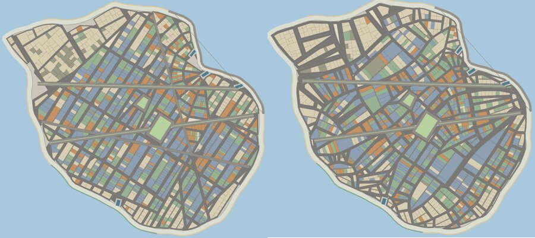
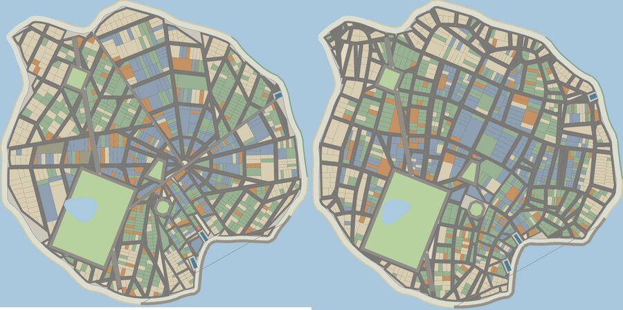
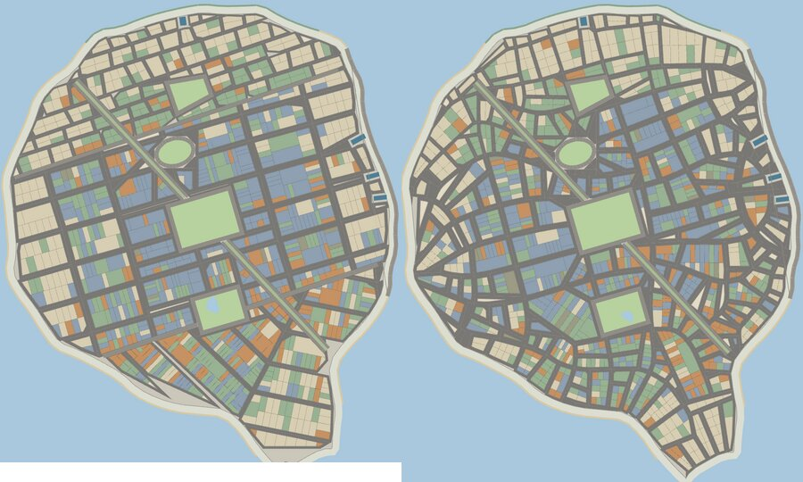

# City generator, next: Natural streets (beta)

Branch `citygen-next`. Opt-in only: a setup choice **Streets: Classic / Natural (beta)**.
Classic stays the default until the owner says otherwise. Code: `src/citygen/natural.mjs`
(the network) and `naturalTown()` in `src/citygen/citygen.mjs` (the network into blocks).

## 1. The complaint, and why it happens

> "it currently feels like there are different templates in the city generation and its a
> very not visually appealing hard line, it doesn't feel natural"

That is literally how the classic generator works:

- **Each district picks a template** from a menu: organic / chamfer / superblock / curvi /
  radial / lattice (`island.mjs` `kindFor`, ~l.1150-1230; builders in `citygen.mjs`
  `latticeDistrict`, `curviDistrict`, `radialDistrict`, `organicDistrict`).
- **Districts sit on 1-3 "surveys" deliberately set 24-90 degrees apart** (`island.mjs`
  THE SURVEYS, ~l.1000-1130), so neighbouring districts' grids meet at large angles.
- **The district partition is a BSP of straight half-planes**, and each district's grid is
  clipped to its leaf. Where two leaves meet there is a straight cut, often drawn as a
  narrow "seam" reservation (`cfg.diagonals[0 .. plan.seams)`).

So every town is a quilt: a rotated grid in the middle, differently-angled grids round it
meeting at straight seams, and a radial fan stamped wherever the radial template landed.
No amount of tuning the bands changes that; the structure is the template.

## 2. The method

One street network for the whole island, grown from the land and from history.

1. **A street-direction field** (a 2-D tensor field, as in Chen, Esch, Wonka, Müller &
   Zhang, *Interactive Procedural Street Modeling*, SIGGRAPH 2008, and the open-source
   MapGenerator that follows it). At each point the field is a weighted sum of basis fields:
   - **shore**: streets run along the water and straight up from it (falls off over ~150 m);
   - **the old town**: rings and spokes round the landing (the harbour head, a little
     inland), over a walking-town radius of 250-420 m, faded out at its very centre so the
     spokes do not knot;
   - **each district's survey**: a grid at its bearing, weighted by a Gaussian blur
     (sigma 170 m) of that district's ground, so one survey turns into the next over a few
     hundred metres instead of at a seam. Planned (lattice/chamfer/superblock) districts are
     held to their grid hardest, the old town least;
   - **squares and boulevards**: streets frame a square and meet a boulevard square on;
   - **creeks**: like a small shore;
   - **wander**: a slow rotation (waves 260-560 m long), +-22 degrees in the old town and
     +-4 in surveyed ground (the North End against the Back Bay).

   A tensor field cannot tell a grid at 0 degrees from the same grid at 90 and would cancel
   them, so each survey is entered at whichever of its two directions lies nearer the field
   already there, with its two block pitches swapped to match.
2. **Arterials first, then streets** (Chen et al. sec. 5): streamlines of the two families
   are traced by RK2 in 5 m steps from the landing and the cores, at four times the block
   pitch, then the ordinary streets at the block pitch the districts already draw (their
   `stPitch`/`avePitch`, so block sizes stay the calibrated ones). A line stops at the shore,
   at a square's frontage, at standing water, or when it comes within 0.62 of a spacing of
   another line of its family; new seeds are dropped a spacing to each side and, for the
   other family, along it.
3. **Blocks from the street graph**: streets, the shore and every square's frontage road are
   noded into a planar graph; dangling ends reach forward up to 3/4 of a block to meet the
   next street, the rest are pruned; the faces are the blocks. A slightly bent face is
   straightened (the street gets the metre or two), a really concave one is cut from its
   reflex corner by a new cross street, an over-large one is cut to the local block size.
4. **Everything after that is the classic pipeline, unchanged**: `claimCell` (shore, parks,
   boulevards, ponds), `pushBlock` (now told each edge's street — arterials are 18-30 m
   between building lines, ordinary streets the district's own width), the wedge rule, the
   frontage plat, land use, settlement order, massing, the map layers, Unreal export.

What is kept: the coast, the districts' roles and flavours, park and boulevard programmes,
civic sites, streams, demand, every name. What is dropped in Natural mode: the survey seam
reservations (the hard lines), and the radial/curvi/chamfer templates as stamped shapes.

Every shape number in `natural.mjs` is commented as calibrated (block pitches, street
widths, which are the districts' own) or set by eye on the six seeds below (falloff radii,
wander, the 0.62 stop distance).

## 3. Before / after (same coast, same seed, same districts)

Rendered with the setup screen's own drawing (`platPreview.mjs`), City size unless noted.
Left: Classic. Right: Natural.

Seed 2967923640 "New Wickmoor", Great City — the owner's screenshot:

Seed 2967923640, City:

Seed 1 "Barrworth Landing":

Seed 20261 "Stanton Bight":

Seed 555 "Yarcott Roads":

Seed 3252 "Barrmere Point":

Seed 481923 "Stancliff Landing":

Measured on the prototype (City size; `tools/platlib.mjs`):

| seed | lots classic | lots natural | change | sliver % (nat) | paved void % cls → nat |
|---|---|---|---|---|---|
| 2967923640 | 951 | 1020 | +7% | 0.0 | 3.1 → 1.9 |
| 1 | 1453 | 1361 | -6% | 0.0 | 5.7 → 4.1 |
| 20261 | 1384 | 1317 | -5% | 0.1 | 3.8 → 2.8 |
| 555 | 1191 | 1071 | -10% | 0.0 | 5.2 → 3.6 |
| 3252 | 1076 | 1129 | +5% | 0.0 | 4.0 → 3.0 |
| 481923 | 999 | 1054 | +6% | 0.1 | 4.6 → 3.1 |
| 2967923640 Great City | 3876 | 3966 | +2% | | |

Lot counts stay inside the classic town-to-town spread (the economy's calibration reads lot
count and area per size preset), and the natural network leaves less unprogrammed asphalt
at the shore than classic. Generation takes ~1.5x as long (0.8-1.6 s per City island).

## 4. Phases

1. **Prototype (this commit)**: the network, blocks and lots through the classic pipeline,
   `makeCity(..., { streets: "natural" })`; before/after images.
2. **Build-out behind the option**: the setup choice; stored with the run (`GameSetup.streets`,
   `GameState.cityStreets`, passed to `makeCity` on every rebuild, like `cityParks`);
   plat preview; water crossings (streets bridge creeks at the island's bridge sites);
   squares at the landing; street naming along the real streets; arterial widths and marking;
   tests (`city-accept`, `citygen-variety`, invariants, `playable-loads`) on Natural cities;
   a scripted few-year playthrough on a Natural town with no page errors.
3. **Draft PR "City generator: Natural streets (beta)"**, merged from main regularly.
4. **After the owner has looked**: the default, and retiring the seams/templates if Natural
   becomes the only generator.

## 5. Risks

- **Economy calibration**: lot count and mean lot size per size preset move a few per cent per
  seed (table above). Within the classic spread, but the default must not change until the
  owner decides; Classic towns are byte-identical (the option is a separate branch of the code).
- **Saves**: a Natural town must rebuild as Natural. The choice is stored with the run and an
  absent field means Classic, so old saves rebuild exactly. No `SAVE_VERSION` bump is needed
  for an additive optional field (to be confirmed against the save loader in phase 2).
- **Junction knots**: where several arterials converge (the landing on seed 20261) the
  roads bunch into a heavy knot of wide streets; a market square at the landing should
  absorb it (phase 2).
- **Small/odd blocks** near converging streets and a wiggly shore; the wedge rule and the
  gore rule already take the worst, sliver % is 0-0.1.
- **Address/street names** are still drawn per block, as for classic organic quarters, not
  per traced street (phase 2).
- **Performance**: ~1.5x generation time; Great City ~2.1 s. Acceptable for the setup preview
  (off-thread) but watched.
