# SHOCK TESTS — results

Generated by `tools/shocks.mjs` (plan: SHOCK_TESTS_PLAN.md). Every number is on a GENERATED city. Twins: the same town and seed, one shocked at year 10, both run 15 years on; every difference is the shock's. Seeds 11, 22, 33; effects are the median across seeds. Windows: year1 = the first year after the shock, impact = years 0-3, mid = 3-8, late = 8-15. `val` is a fixed sample's appraised value at the market's own cap read; `inc` is the same sample at the snapshot's cap read (the income channel); `lots` is the land read on a fixed lot panel, quarterly. `pp` = percentage points; `%` = relative to the control's mean over the window.

Verdicts: **RIGHT** (direction and size inside the record's range) · **WRONG SIZE** · **BACKWARDS** · **NO RESPONSE** · **SPILLS** (moved where it should not) · **DID NOT LAND** (the injection did not take, so nothing else about the shock means anything).

## Summary

| group | shock | verdict |
|---|---|---|
| capital | Rates +300bp, held | **WRONG SIZE** |
| capital | Rates near zero for 10 years | **BACKWARDS** |
| capital | Credit crunch: max LTV and loan sizing halved for 3 years | **NO RESPONSE** |
| capital | Foreign capital wave, high end | **DID NOT LAND** |
| cost | Construction cost +40%, held | **BACKWARDS** |
| cost | Insurance ×2 and energy ×2, held | **WRONG SIZE** |
| cost | Property tax rate ×2, held | **BACKWARDS** |
| demand | The largest employer leaves | **BACKWARDS** |
| demand | +30% population over 2 years | **BACKWARDS** |
| demand | Remote work: office space per worker −30% | **RIGHT** |
| demand | E-commerce: 20% of shop spending moves online | **BACKWARDS** |
| placebo | Placebo: a shock of nothing (the noise floor) | **SPILLS** |
| supply | +50% office stock overnight | **WRONG SIZE** |
| supply | −20% office stock lost | **RIGHT** |
| supply | +50% retail stock overnight | **BACKWARDS** |
| supply | −20% retail stock lost | **WRONG SIZE** |
| supply | +50% industrial stock overnight | **WRONG SIZE** |
| supply | −20% industrial stock lost | **NO RESPONSE** |
| supply | +50% apartments stock overnight | **WRONG SIZE** |
| supply | −20% apartments stock lost | **BACKWARDS** |

## Findings, worst first

1. **Foreign capital wave, high end** — DID NOT LAND: 61% of the wave's $161M raised by +10 months, in 10 funds; at most 25 deeds held by them; 76% of the wave's $120M raised by +10 months, in 10 funds; at most 20 deeds held by them
2. **Rates near zero for 10 years** — ten-year (loan index), years 3-8: +6.5pp (mid), expected falls 0.75-3.5 points as the market learns the bank rests at zero. BACKWARDS.
3. **Construction cost +40%, held** — apartment values (existing): -4.5% (mid), expected rise somewhat: +1 to +25%. BACKWARDS.
4. **Property tax rate ×2, held** — population, years 8-15: +0.7% (late), expected a little out-migration (Tiebout): −0.2 to −5%. BACKWARDS.
5. **The largest employer leaves** — population: +0.1% (impact), expected some laid-off households leave town. BACKWARDS. Trace: households.ts moves (a job loss as a reason to leave)
6. **The largest employer leaves** — apartment vacancy: -0.1pp (impact), expected rises over 1-2 years as leavers' flats come empty. BACKWARDS.
7. **+30% population over 2 years** — apartment vacancy: +1.2pp (impact), expected falls first. BACKWARDS.
8. **E-commerce: 20% of shop spending moves online** — shop vacancy, years 8-15: -3.0pp (late), expected stays up until shops convert. BACKWARDS.
9. **+50% retail stock overnight** — retail vacancy, years 8-15: -4.5pp (late), expected smaller than the impact: absorbing (0 to +20pp). BACKWARDS.
10. **−20% apartments stock lost** — apartments starts, years 3-8: -18.2% (mid), expected rise: a construction answer 1-3 years on. BACKWARDS.
11. **Credit crunch: max LTV and loan sizing halved for 3 years** — lenders' cumulative charge-offs: +0.3% (impact), expected rise. NO RESPONSE.
12. **Property tax rate ×2, held** — office values, cap read held: +0.0% (year1), expected fall by Δtax × owner's share ÷ (cap + tax): 0.55pt × ½ ÷ 8-17% ≈ 1.5-3.5% (Yinger et al. 1988: 30-90% capitalised). NO RESPONSE. Trace: tax line in NOI (value.ts grossTaxYr, taxRate, taxBorneShare) and its recovery by lease
13. **E-commerce: 20% of shop spending moves online** — shop stock, years 8-15: -0.4% (late), expected conversions where they pencil. NO RESPONSE.
14. **−20% industrial stock lost** — industrial vacancy: +0.0pp (impact), expected falls 1-12pp (the displaced take the empty space). NO RESPONSE. Trace: do the displaced tenants relocate in town (toSeekers) or vanish?
15. **Placebo: a shock of nothing (the noise floor)** — jobs, years 3-8: -0.2% (mid), expected nothing. SPILLS.
16. **Placebo: a shock of nothing (the noise floor)** — industrial values, market read (val): -2.5% (impact), expected nothing: any move is the noise floor. SPILLS.
17. **+50% retail stock overnight** — apartments rent (should not move): +5.4% (impact), expected within ±5%. SPILLS.
18. **Rates +300bp, held** — ten-year (loan index): +0.5pp (impact), expected +1 to +2.5 points (2022: +2.5 on a +4.25 policy move). WRONG SIZE. Trace: market.ts expectedPolicyAvg / endShift: does the bond market believe a held rate?
19. **Rates +300bp, held** — office values: -15.0% (impact), expected fall 15-45%. WRONG SIZE.
20. **Rates +300bp, held** — apartment values: -9.0% (impact), expected fall 10-30% (about −20%). WRONG SIZE.
21. **Credit crunch: max LTV and loan sizing halved for 3 years** — deal volume (sales a month): -26.4% (impact), expected collapses 30-85%. WRONG SIZE.
22. **Credit crunch: max LTV and loan sizing halved for 3 years** — starts, all classes: -5.0% (impact), expected fall 20-90% (construction loans halved). WRONG SIZE.
23. **Insurance ×2 and energy ×2, held** — apartment starts, years 3-8: -75.5% (mid), expected fall (lower NOI on a new block). WRONG SIZE.
24. **The largest employer leaves** — the class's occupied floor, per foot the firm held (×100): -24.2pp (impact), expected about −100 (its floor comes empty), −50 to −150. WRONG SIZE. Trace: do the suites re-let at once (streetRolls.ts new firms, `form`)?
25. **The largest employer leaves** — town jobs lost per direct job (×100): -89.3pp (impact), expected −150 to −250: the direct job and 0.5-1.5 more (Moretti 2010). WRONG SIZE. Trace: is the industry hired back at once (economy.ts `staff`, the off-map sample `off`)?
26. **+30% population over 2 years** — unemployment: +12.1pp (impact), expected up briefly (newcomers looking for work). WRONG SIZE.
27. **E-commerce: 20% of shop spending moves online** — shop vacancy, years 0-3: +0.7pp (impact), expected rises as marginal shops close. WRONG SIZE. Trace: shop firms' books (tenantBooks.ts) and exits (streetRolls.ts)
28. **E-commerce: 20% of shop spending moves online** — shop effective rent: -2.4% (impact), expected falls 3-30%. WRONG SIZE.
29. **+50% office stock overnight** — office stock, years 3-8: +31.9% (mid), expected the new buildings still stand (+35 to +55%): a glut is absorbed, not torn down — new buildings are rarely demolished. WRONG SIZE. Trace: teardown / owner redevelopment of new empty buildings (dev.ts tickTeardowns, ownerRedevelopment)
30. **+50% retail stock overnight** — retail effective rent: -6.7% (impact), expected falls 8-50%. WRONG SIZE. Trace: rent rule for the class (streetRolls.ts / tenantMarket.ts)
31. **+50% retail stock overnight** — retail starts, years 3-8: -30.8% (mid), expected near zero: −50 to −100%. WRONG SIZE. Trace: builders' pro formas (dev.ts developerLook)
32. **+50% retail stock overnight** — retail stock, years 3-8: +26.8% (mid), expected the new buildings still stand (+35 to +55%): a glut is absorbed, not torn down — new buildings are rarely demolished. WRONG SIZE. Trace: teardown / owner redevelopment of new empty buildings (dev.ts tickTeardowns, ownerRedevelopment)
33. **−20% retail stock lost** — retail vacancy: -1.0pp (impact), expected falls 1-12pp (the displaced take the empty space). WRONG SIZE. Trace: do the displaced tenants relocate in town (toSeekers) or vanish?
34. **+50% industrial stock overnight** — industrial stock, years 3-8: +18.6% (mid), expected the new buildings still stand (+35 to +55%): a glut is absorbed, not torn down — new buildings are rarely demolished. WRONG SIZE. Trace: teardown / owner redevelopment of new empty buildings (dev.ts tickTeardowns, ownerRedevelopment)
35. **+50% apartments stock overnight** — apartments vacancy: +6.9pp (impact), expected +10 to +35pp (day one is about +30pp). WRONG SIZE.
36. **+30% population over 2 years** — home prices, years 3-8: — (mid), expected follow the rents up. NO DATA.

## Rates +300bp, held

The central bank's policy rate (econ.nat.policy, market.ts tickNation) floored, before every month, at what the CONTROL twin's rate was that month + 3 points (the framework runs the controls first and hands a shocked run its twin's path: `needsControl`). Inside a month the committee still meets (8 months in 12) and steps from the floor toward its own rule, a quarter to three-quarters of a point down, so the month runs a little under the floor; the floor is restored before the next month. The ten-year and the short index are left to the engine. The audit's old indexRate floor (econaudit.mjs exp. 4) is not used: tickNation rewrites indexRate later in the same month, so it never took.

- Twins identical before the shock: yes · landing: policy +300bp and ten-year +27bp at +1 month; policy +266bp over the first year / policy +300bp and ten-year +25bp at +1 month; policy +261bp over the first year / policy +300bp and ten-year +23bp at +1 month; policy +255bp over the first year · holding: policy +201bp at +5 years (+252bp averaged over years 0-5; ten-year +72bp) / policy +257bp at +5 years (+253bp averaged over years 0-5; ten-year +56bp) / policy +200bp at +5 years (+252bp averaged over years 0-5; ten-year +71bp)
- Injector notes: policy floored at the control's rate + 3 before every month (7.21% at the shock); policy floored at the control's rate + 3 before every month (7.73% at the shock); policy floored at the control's rate + 3 before every month (4.98% at the shock)
- Record: 2022-24: fed funds +4.25 points, the ten-year +2.5; cap rates widened 100-200bp over 1-3 years with partial pass-through (Chervachidze & Wheaton 2013); values fell 15-30% (apartments about −20%, office −30% or more); 2023 US deal volume about −50% (MSCI RCA); refinancing failures where balloons fell due; starts down after 1-2 years.

| observable | window | effect, median (by seed) | peak | the record says | verdict |
|---|---|---|---|---|---|
| ten-year (loan index) | impact | +0.5pp (+0.6pp, +0.4pp, +0.5pp) | peak +1.1pp at 4.8y | +1 to +2.5 points (2022: +2.5 on a +4.25 policy move) | **WRONG SIZE** |
| office cap rate | impact | +0.9pp (+0.7pp, +0.9pp, +1.2pp) | peak +2.4pp at 6.2y | +50 to +200bp over 1-3 years, less than the rate move | **RIGHT** |
| apartments cap rate | impact | +0.7pp (+0.3pp, +0.7pp, +0.7pp) | peak +2.1pp at 7.2y | +50 to +200bp over 1-3 years, less than the rate move | **RIGHT** |
| office values | impact | -15.0% (-10.1%, -15.0%, -17.7%) | peak -46.5% at 6.3y | fall 15-45% | **WRONG SIZE** |
| apartment values | impact | -9.0% (-5.6%, -12.7%, -9.0%) | peak -83.7% at 6y | fall 10-30% (about −20%) | **WRONG SIZE** |
| deal volume (sales a month) | impact | -47.9% (-49.5%, -47.9%, -41.3%) | peak -263.7% at 1.6y | falls 20-80% (2023: about −50%) | **RIGHT** |
| distressed listings | impact | +80.6% (+22.1%, +136.0%, +80.6%) | peak +418.4% at 6.9y | rise: balloons that cannot refinance | **RIGHT** |
| lenders' cumulative charge-offs, years 3-8 | mid | +186.1% (+255.8%, -1.9%, +186.1%) | peak +422.4% at 7.8y | rise | **RIGHT** |
| starts, all classes, years 3-8 | mid | -64.3% (-64.3%, -62.6%, -78.4%) | peak -723.7% at 5.4y | fall 10-80% after 1-2 years | **RIGHT** |
| office effective rent, years 0-3 | impact | -0.8% (+0.6%, -1.2%, -0.8%) | peak -21.2% at 7.3y | barely moves at first (within ±5%); NOI is not the channel | **RIGHT** |
| retail effective rent, years 0-3 | impact | -0.5% (-1.6%, +2.3%, -0.5%) | peak -30.4% at 7.9y | barely moves at first (within ±5%); NOI is not the channel | **RIGHT** |
| industrial effective rent, years 0-3 | impact | -0.9% (-0.9%, -0.2%, -2.2%) | peak -29.6% at 7.2y | barely moves at first (within ±5%); NOI is not the channel | **RIGHT** |
| apartments effective rent, years 0-3 | impact | -1.7% (-2.8%, -1.7%, -0.3%) | peak -35.0% at 7.3y | barely moves at first (within ±5%); NOI is not the channel | **RIGHT** |

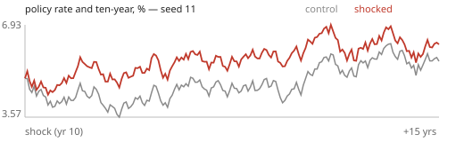
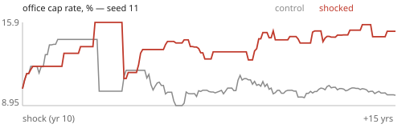
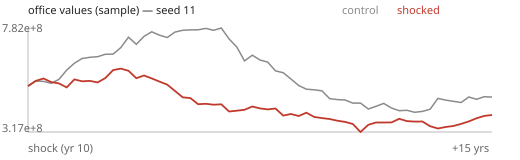

## Rates near zero for 10 years

The central bank's policy rate (econ.nat.policy, market.ts tickNation) set to 0.25% before every month for 120 months, then released to the committee's own rule. Inside a month the committee still meets and steps from 0.25% toward its rule (up a quarter to three-quarters of a point at a meeting); the peg is restored before the next month. The ten-year and the short index are the engine's.

- Twins identical before the shock: yes · landing: policy 0.25% (-396bp) and ten-year -26bp at +1 month / policy 0.25% (-448bp) and ten-year -27bp at +1 month / policy 0.25% (-173bp) and ten-year -7bp at +1 month · holding: policy 1.00% at +5 years, at most 1.00% in any month (-297bp against the control over years 0-5; ten-year +21bp) / policy 1.00% at +5 years, at most 1.00% in any month (-285bp against the control over years 0-5; ten-year +17bp) / policy 1.00% at +5 years, at most 1.00% in any month (-169bp against the control over years 0-5; ten-year +9bp)
- Injector notes: policy pegged at 0.25% (snapshot 4.21%) before each of the first 120 months, then released; policy pegged at 0.25% (snapshot 4.73%) before each of the first 120 months, then released; policy pegged at 0.25% (snapshot 1.98%) before each of the first 120 months, then released
- Record: 2009-15 and 2020-21: policy at the zero bound; the ten-year near 2%; US cap rates compressed over years (about 8% to 5.5% 2009-2019); land prices and leverage rose; starts rose. When rates normalised (2022-24), the reverse, and distress concentrated in loans written at the top.

| observable | window | effect, median (by seed) | peak | the record says | verdict |
|---|---|---|---|---|---|
| ten-year (loan index), years 3-8 | mid | +6.5pp (+6.5pp, +6.5pp, +4.2pp) | peak +20.9pp at 8y | falls 0.75-3.5 points as the market learns the bank rests at zero | **BACKWARDS** |
| office cap rate, years 3-8 | mid | -1.3pp (-1.3pp, -0.9pp, -1.5pp) | peak -1.9pp at 7.2y | compresses 50-250bp over years | **RIGHT** |
| apartments cap rate, years 3-8 | mid | -0.8pp (-0.8pp, -0.7pp, -0.8pp) | peak -1.9pp at 4.6y | compresses 50-250bp over years | **RIGHT** |
| land value, years 3-8 | mid | +10.3% (+10.3%, -18.7%, +21.7%) | peak +149.7% at 7y | inflates (10-150%) | **RIGHT** |
| the street's mortgage book, years 3-8 | mid | +20.7% (+25.4%, +20.7%, +0.6%) | peak +60.5% at 7.8y | leverage builds up (10-100%) | **RIGHT** |
| starts, all classes, years 3-8 | mid | +47.3% (+47.3%, +76.7%, -16.0%) | peak +1012.2% at 3.9y | rise | **RIGHT** |
| office values, years 3-8 | mid | +65.4% (+65.4%, +67.5%, +56.6%) | peak +109.6% at 6.8y | rise | **RIGHT** |
| distressed listings, years 8-15 (after release at year 10) | late | +245.7% (+34.9%, +264.7%, +245.7%) | peak +342.5% at 8y | rise when rates normalise: loans written at the top | **RIGHT** |

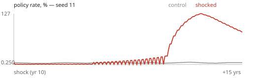
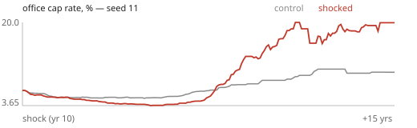
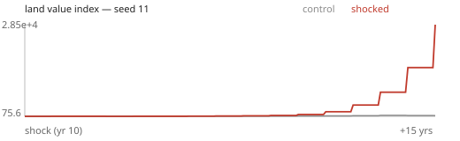

## Credit crunch: max LTV and loan sizing halved for 3 years

For 36 months every lender's product terms are cut through the sheets themselves: each permanent, bridge, land and mezzanine sheet's advance rate (debt.ts PRODUCTS and INTERNAL_PRODUCTS `ltv`) halved, its underwriting coverage (`uwDscr`) and debt-yield floor (`debtYield`) doubled, so each of the three sizing tests in `quote` writes about half the loan; and every construction desk's advance (proforma.ts constructionDesks `scale` and `cap`) halved. Every loan in town is sized through these: the player's quotes, the street's refinancings and acquisition loans (streetRefiProceeds, rivalDebt deskQuotes), the bidders' debt in a sale (propmarket dealView), facilities (facility.ts statedLtv) and construction loans (deskQuote). Covenants on loans already written (`maxLTV`, `minDSCR`, copied onto each loan at origination) are not touched. Restored at +36 months.

- Twins identical before the shock: yes · landing: the street's best advance on a reference building ×0.49 at +1 month (31% against 64%) / the street's best advance on a reference building ×0.50 at +1 month (37% against 75%) / the street's best advance on a reference building ×0.49 at +1 month (35% against 72%) · holding: advance ×0.52 at +30 months (in force), ×1.11 at +5 years (released at +3) / advance ×0.45 at +30 months (in force), ×1.13 at +5 years (released at +3) / advance ×0.46 at +30 months (in force), ×0.97 at +5 years (released at +3)
- Injector notes: 17 loan sheets and 4 construction desks halved for 36 months; the street's best advance on a reference building 68% → 33% of value; 17 loan sheets and 4 construction desks halved for 36 months; the street's best advance on a reference building 78% → 39% of value; 17 loan sheets and 4 construction desks halved for 36 months; the street's best advance on a reference building 71% → 35% of value
- Record: 2008-10: CMBS issuance stopped, bank advance rates fell from 75-80% to 50-60% and coverage tests rose (Fed SLOOS); US commercial deal volume fell about 70-80% 2007-09 (RCA); distressed and forced sales rose as balloons could not refinance; prices fell more than rents (Moody's/RCA CPPI −35-40%); equity-rich buyers bought cheap.

| observable | window | effect, median (by seed) | peak | the record says | verdict |
|---|---|---|---|---|---|
| deal volume (sales a month) | impact | -26.4% (-30.9%, -20.5%, -26.4%) | peak +369.2% at 4y | collapses 30-85% | **WRONG SIZE** |
| distressed listings | impact | +34.7% (+34.7%, +79.4%, -5.5%) | peak -128.4% at 7.2y | rise: balloons that cannot refinance | **RIGHT** |
| lenders' cumulative charge-offs | impact | +0.3% (-1.9%, +0.3%, +28.5%) | peak +27.3% at 5.7y | rise | **NO RESPONSE** |
| the street's mortgage book | impact | -6.4% (-10.2%, -6.4%, -6.4%) | peak -36.1% at 7.6y | shrinks as loans pay down and are not rewritten | **RIGHT** |
| office values | impact | -25.4% (-29.9%, -25.4%, -25.4%) | peak -37.9% at 3y | fall 10-45%, more than rents | **RIGHT** |
| apartment values | impact | -26.5% (-28.8%, -26.5%, -21.9%) | peak -39.6% at 7.5y | fall 10-40% | **RIGHT** |
| starts, all classes | impact | -5.0% (-54.1%, -5.0%, +18.7%) | peak -617.2% at 3.4y | fall 20-90% (construction loans halved) | **WRONG SIZE** |
| office effective rent | impact | +0.3% (+0.6%, +0.0%, +0.3%) | peak +7.1% at 7.4y | within ±5%: prices fall more than rents | **RIGHT** |
| retail effective rent | impact | -1.4% (-3.4%, -0.8%, -1.4%) | peak -10.6% at 6.3y | within ±5%: prices fall more than rents | **RIGHT** |
| industrial effective rent | impact | +2.2% (+0.4%, +2.7%, +2.2%) | peak -8.5% at 6.3y | within ±5%: prices fall more than rents | **RIGHT** |
| apartments effective rent | impact | +0.3% (-3.9%, +0.3%, +3.9%) | peak -16.8% at 5.4y | within ±5%: prices fall more than rents | **RIGHT** |

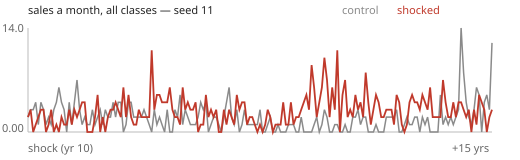
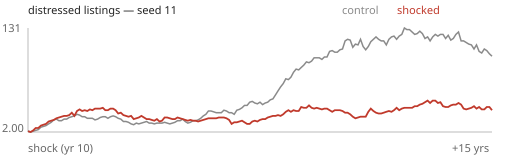
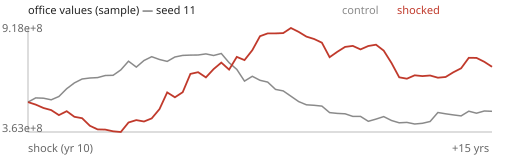

## Foreign capital wave, high end

The capital-wave swan's state set directly, as blackswans.ts startCapitalWave sets it, with its one draw fixed at the top of its range: econ.capWave = { phase "in", 36 months, depth -1.5, share 0.1 } — money abroad worth 10% of the street's book, which rivals.ts tickForeignMoney raises as named foreign funds (one first close a month, cash, no buildings) and which reaches prices only through what they bid. (startCapitalWave itself draws its depth from the shock stream, so it is not called.) From there the swan runs its own life: hold 12-24 months, then the money goes home and the funds sell.

- Twins identical before the shock: yes · landing: 1 foreign fund(s) raised at +1 month (control 0); the wave's money $161M / 1 foreign fund(s) raised at +1 month (control 0); the wave's money $120M / 1 foreign fund(s) raised at +1 month (control 0); the wave's money $99M · holding: 61% of the wave's $161M raised by +10 months, in 10 funds; at most 25 deeds held by them / 76% of the wave's $120M raised by +10 months, in 10 funds; at most 20 deeds held by them / 83% of the wave's $99M raised by +10 months, in 10 funds; at most 12 deeds held by them
- Injector notes: capWave set: phase in, 36 months, share 0.1 of a street book of about $1606M; capWave set: phase in, 36 months, share 0.1 of a street book of about $1200M; capWave set: phase in, 36 months, share 0.1 of a street book of about $990M
- Record: Japan 1985-91: Japanese investors held about 5-10% of US institutional commercial property at the peak, a third of downtown Los Angeles offices (Farrell 1993); trophy assets first; prices up with rents flat (caps compressed); reversal 1991-95 with heavy losses for late buyers.

| observable | window | effect, median (by seed) | peak | the record says | verdict |
|---|---|---|---|---|---|
| office values | impact | -1.4% (+2.2%, -9.5%, -1.4%) | peak -17.8% at 6.3y | rise 5-50%, trophy first | **—** |
| office cap rate | impact | +0.2pp (-0.0pp, +0.9pp, +0.2pp) | peak -0.7pp at 8y | compresses 20-150bp | **—** |
| apartment cap rate | impact | -0.1pp (-0.1pp, +0.7pp, -0.5pp) | peak +1.6pp at 2.7y | compresses | **—** |
| deal volume | impact | +19.8% (-3.1%, +20.5%, +19.8%) | peak +296.5% at 3.5y | rises: the funds buy | **—** |
| office effective rent | impact | +0.1% (+0.7%, -0.1%, +0.1%) | peak -5.3% at 6.3y | unchanged (within ±5%): rents moving is a miswiring | **—** |
| retail effective rent | impact | -0.0% (-0.9%, +1.7%, -0.0%) | peak -10.3% at 7.1y | unchanged (within ±5%): rents moving is a miswiring | **—** |
| industrial effective rent | impact | +1.2% (+0.6%, +3.3%, +1.2%) | peak -23.7% at 6.9y | unchanged (within ±5%): rents moving is a miswiring | **—** |
| apartments effective rent | impact | -0.8% (-0.8%, +2.1%, -0.8%) | peak -19.3% at 6.7y | unchanged (within ±5%): rents moving is a miswiring | **—** |
| office values, years 8-15 | late | -3.3% (+19.6%, -26.8%, -3.3%) | peak -17.8% at 6.3y | back to the control (±10%) once the money has gone | **—** |

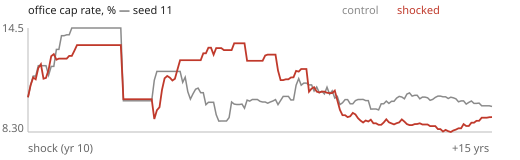
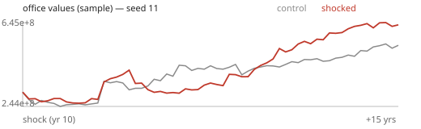
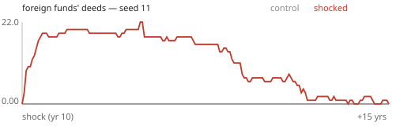

## Construction cost +40%, held

The contractors' direct cost raised 40% overnight and left there: last month's materials price and site wage in the cost block (market.ts, `costInputsPrev.mat` and `.wage`) are divided by 1.4, so the input index's own monthly growth step (55% materials, 45% labour) adds exactly +40%, and the level compounds from there like the control's. Materials alone would be +22% of cost (they are 55% of direct cost), so both inputs move. The bid markup (contractors.ts) and the cost index `costIdx` are not written: they answer.

- Twins identical before the shock: yes · landing: direct cost (costInputIdx) ×1.400, costIdx ×1.400 at +1 month / direct cost (costInputIdx) ×1.401, costIdx ×1.401 at +1 month / direct cost (costInputIdx) ×1.400, costIdx ×1.400 at +1 month · holding: direct cost ×1.427, costIdx ×1.281 (markup 0.163 → 0.045) at +5 years / direct cost ×1.416, costIdx ×1.348 (markup 0.131 → 0.078) at +5 years / direct cost ×1.407, costIdx ×1.246 (markup 0.080 → -0.044) at +5 years
- Injector notes: materials and site wage both ÷1.4 in costInputsPrev at the snapshot: direct cost 0.4853 steps +40% on the next tick (costIdx was 0.5138, markup 0.0587); materials and site wage both ÷1.4 in costInputsPrev at the snapshot: direct cost 0.5712 steps +40% on the next tick (costIdx was 0.6288, markup 0.1007); materials and site wage both ÷1.4 in costInputsPrev at the snapshot: direct cost 0.5106 steps +40% on the next tick (costIdx was 0.5238, markup 0.0259)
- Record: 2021-22: US construction input prices +35-40% (BLS PPI inputs to construction), Turner index +16% over two years; residual land value = value − cost, so a cost rise falls on land first (DiPasquale & Wheaton 1996 ch. 7); starts fall when replacement cost exceeds value (Tobin's q for buildings); existing buildings gain as replacement cost rises.

| observable | window | effect, median (by seed) | peak | the record says | verdict |
|---|---|---|---|---|---|
| construction cost index (bids) | impact | +31.1% (+25.4%, +31.1%, +33.0%) | peak +43.8% at 7.8y | +25 to +45%: the 40% input rise, less what idle contractors shave off their markup | **RIGHT** |
| office starts, years 3-8 | mid | -44.6% (-58.2%, -13.1%, -44.6%) | peak -1114.7% at 4.5y | fall sharply: −30 to −100% | **RIGHT** |
| apartment starts, years 3-8 | mid | -34.4% (-14.9%, -53.8%, —) | peak -2453.8% at 3.3y | fall sharply: −30 to −100% | **RIGHT** |
| apartment starts, % of the stock a year, years 3-8 | mid | -0.3pp (-0.1pp, -0.3pp, -0.7pp) | peak -28.8pp at 3.3y | no higher than without the shock (≤ 0pp) | **RIGHT** |
| industrial starts, years 3-8 | mid | -94.1% (—, —, -94.1%) | peak -1304.3% at 6.6y | fall sharply: −30 to −100% | **RIGHT** |
| land value | impact | -15.8% (-13.2%, -15.8%, -31.3%) | peak -49.3% at 5y | FALLS 5-80% (residual = value − cost); a rise is a backwards wire | **RIGHT** |
| land value, years 3-8 | mid | -23.6% (-27.0%, -13.2%, -23.6%) | peak -49.3% at 5y | stays down | **RIGHT** |
| office values (existing buildings) | mid | +12.2% (+0.1%, +12.2%, +17.8%) | peak +31.5% at 7.5y | rise somewhat (replacement cost up): +1 to +25% | **RIGHT** |
| apartment values (existing) | mid | -4.5% (-4.5%, -6.4%, +1.6%) | peak -33.0% at 5y | rise somewhat: +1 to +25% | **BACKWARDS** |
| apartment rent, years 8-15 | late | +26.2% (+36.9%, +21.6%, +26.2%) | peak +51.7% at 7.6y | drifts up as supply stops answering demand: +2 to +40% | **RIGHT** |
| office rent, years 8-15 | late | +10.1% (+10.1%, +17.6%, +3.0%) | peak +6.5% at 7.8y | drifts up: +2 to +40% | **RIGHT** |

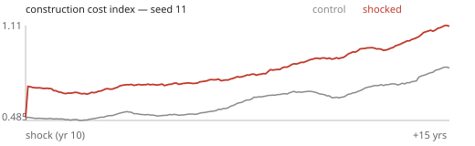
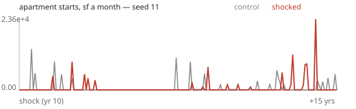
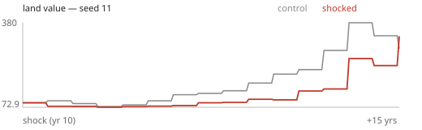

## Insurance ×2 and energy ×2, held

The owner's two outside bills doubled and held (inputs.ts tickOpexInputs). Insurance: the property-insurance market's price `opexIdx.ins` raised by ln 2 and its capital `insCap` held ln 2 below its own path (each month the engine's capital rebuild, ln 2 × (1/12 + 1/36), is taken back), so the rate target and the premium both stay ×2 against the control. Energy: last month's energy price in `opexPrev.energy` halved at the snapshot, so the utilities index steps ×2 on its own growth rule and compounds from there. Labour, repairs and the cost index are not touched; leases decide who pays.

- Twins identical before the shock: yes · landing: insurance rate ×2.000, energy ×2.000 at +1 month (fixed stack ×2.000, office controllable ×1.229) / insurance rate ×2.000, energy ×2.000 at +1 month (fixed stack ×2.000, office controllable ×1.217) / insurance rate ×2.000, energy ×2.000 at +1 month (fixed stack ×2.000, office controllable ×1.249) · holding: insurance rate ×2.000, energy ×2.000 at +5 years / insurance rate ×2.000, energy ×2.000 at +5 years / insurance rate ×2.000, energy ×2.000 at +5 years
- Injector notes: insurance: ins -0.039 → 0.654 (premium ×2), insCap 0.021 → -0.673; energy: opexPrev.energy halved, utilities index 0.4320 steps ×2 next tick; insurance: ins -0.044 → 0.650 (premium ×2), insCap 0.042 → -0.651; energy: opexPrev.energy halved, utilities index 0.4769 steps ×2 next tick; insurance: ins -0.007 → 0.686 (premium ×2), insCap 0.039 → -0.654; energy: opexPrev.energy halved, utilities index 0.4801 steps ×2 next tick
- Record: US commercial property insurance rates +60% cumulatively 2019-23, multifamily premiums roughly doubled in Florida/Texas (Marsh Global Insurance Market Index; NMHC 2023); European energy 2022 (commercial power ×2-3). Under NNN leases tenants pay taxes, insurance and utilities (landlords barely notice); gross and apartment owners eat it until leases roll; values fall with NOI (BOMA EER: utilities ~25% of office controllable opex).

| observable | window | effect, median (by seed) | peak | the record says | verdict |
|---|---|---|---|---|---|
| office values, cap read held (base-year leases) | year1 | -1.8% (-0.8%, -3.6%, -1.8%) | peak -9.4% at 5.8y | fall 1-25%, less than apartments: the owner keeps about half the step once leases roll and reset their stops | **RIGHT** |
| apartment values, cap read held (gross) | year1 | -11.5% (-13.8%, -11.5%, -10.9%) | peak -45.9% at 7.8y | fall 2-25%: a flat's lease is gross | **RIGHT** |
| industrial values, cap read held (NNN) | year1 | -2.1% (-3.7%, +2.8%, -2.1%) | peak -38.2% at 6.5y | barely move: within ±4% (tenants pay it) | **RIGHT** |
| retail values, cap read held (NNN / CAM) | year1 | -1.9% (-1.9%, -1.3%, -3.4%) | peak -19.2% at 6y | barely move: within ±5% | **RIGHT** |
| apartment starts, years 3-8 | mid | -75.5% (-73.9%, -77.2%, —) | peak -2453.8% at 3.3y | fall (lower NOI on a new block) | **WRONG SIZE** |

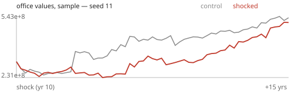
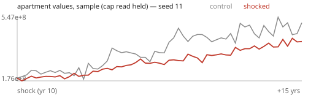
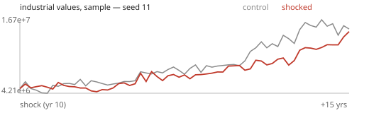

## Property tax rate ×2, held

City Hall's adopted property-tax rate (citygov.ts `policy.propRate`, published as `econ.taxMult`) set to twice its snapshot value and re-imposed at the start of every month as an outside mandate (a state law). The council's budget logic still runs each July and may try to cut it; the end-of-month rate is recorded so a pull-back shows. Assessments, abatements and leases are not touched.

- Twins identical before the shock: yes · landing: rate 0.550% → 1.100% at +1 month (×2.000; control 0.550%) / rate 0.550% → 1.100% at +1 month (×2.000; control 0.550%) / rate 0.550% → 1.100% at +1 month (×2.000; control 0.550%) · holding: rate ×2.000 of snapshot at +5 years; end-of-month rate off the mandate in 5/60 months (lowest 1.549×), restored each next month; control at +5y ×1.000 / rate ×2.000 of snapshot at +5 years; end-of-month rate off the mandate in 5/60 months (lowest 1.549×), restored each next month; control at +5y ×1.000 / rate ×2.000 of snapshot at +5 years; end-of-month rate off the mandate in 5/60 months (lowest 1.549×), restored each next month; control at +5y ×1.000
- Injector notes: propRate 0.550% → 1.100% (statutory 1.10%, rail 50-250% of it), re-imposed monthly; month +6: council had moved the rate to 0.877%; restored; month +18: council had moved the rate to 0.877%; restored; month +30: council had moved the rate to 0.852%; restored; month +6: council had moved the rate to 0.852%; restored; month +30: council had moved the rate to 0.877%; restored
- Record: Tax capitalisation: a rise in the effective rate falls on value by about Δtax ÷ cap rate (Oates 1969; Yinger et al. 1988, 30-90% capitalisation), less what NNN leases pass to tenants; Tiebout sorting: a little out-migration over years (ledger #14); Proposition 13-era California and New Jersey's high rates as the record of a held rate.

| observable | window | effect, median (by seed) | peak | the record says | verdict |
|---|---|---|---|---|---|
| office values, cap read held | year1 | +0.0% (+0.0%, -4.3%, +1.6%) | peak -11.4% at 5.8y | fall by Δtax × owner's share ÷ (cap + tax): 0.55pt × ½ ÷ 8-17% ≈ 1.5-3.5% (Yinger et al. 1988: 30-90% capitalised) | **NO RESPONSE** |
| apartment values, cap read held | year1 | -5.7% (-8.5%, -5.7%, -4.9%) | peak -28.7% at 7.3y | fall 0.55pt ÷ (cap + tax) ≈ 4-6.5%; 1-15% | **RIGHT** |
| industrial values, cap read held (NNN) | year1 | -1.2% (-4.9%, +2.9%, -1.2%) | peak -47.3% at 7y | fall less: 0-8% (tenants pay the tax at today's rents) | **RIGHT** |
| land, lot panel | year1 | -8.6% (-5.6%, -14.2%, -8.6%) | peak -65.6% at 5y | falls 2-30% (the tax capitalises into land) | **RIGHT** |
| listings | impact | +11.2% (-6.1%, +40.3%, +11.2%) | peak -57.2% at 7.5y | rise: marginal owners sell | **RIGHT** |
| population, years 8-15 | late | +0.7% (-0.2%, +0.8%, +0.7%) | peak -1.0% at 8y | a little out-migration (Tiebout): −0.2 to −5% | **BACKWARDS** |

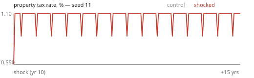
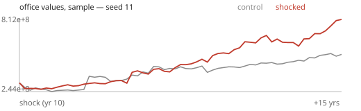
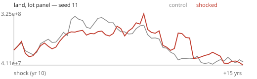

## The largest employer leaves

The named firm with the most heads closes its local operation at the snapshot. It goes the way a street firm that fails goes (streetRolls.ts `tickFirms`, the dark path): every lease it holds ends, the suites go to make-ready and back on the market, the closure is filed (`streetFailed`, `failedSf`), and it leaves the search queue. The town's books then close it as they close any firm missing from the street (economy.ts `tickFirms`): its heads come off its industry's employment that month, the register lets its earners go, and its supply links lapse. Not written: the replacement — whether new firms form into the gap is the engine's answer.

- Twins identical before the shock: yes · landing: the firm's heads 391 (control) vs 0 (shocked) at +1 month; town jobs -1.29 per direct job by +2 months; its class's occupied floor -0.94× its floor at +1 month / the firm's heads 958 (control) vs 0 (shocked) at +1 month; town jobs -1.06 per direct job by +2 months; its class's occupied floor -0.91× its floor at +1 month / the firm's heads 297 (control) vs 0 (shocked) at +1 month; town jobs -1.37 per direct job by +2 months; its class's occupied floor -1.21× its floor at +1 month
- Injector notes: Kemble & Pell Insurance (fid 28, office): 373 heads = 0.68% of the town's jobs; 1 lease(s), 65.1k sf = 0.92% of office stock; Alden & Dunmore Technologies (fid 1239, office): 918 heads = 1.63% of the town's jobs; 1 lease(s), 54.2k sf = 0.87% of office stock; Lyle & Mercer Technologies (fid 31, office): 305 heads = 0.57% of the town's jobs; 1 lease(s), 66.9k sf = 0.99% of office stock
- Record: Plant closures cost a metro about 0.5-1.5 further local jobs per direct job (Moretti 2010 multipliers, run in reverse); office vacancy rises by about the firm's floor; some laid-off households leave, so apartment vacancy rises over 1-2 years; shops follow with a lag.

| observable | window | effect, median (by seed) | peak | the record says | verdict |
|---|---|---|---|---|---|
| the class's occupied floor, per foot the firm held (×100) | impact | -24.2pp (-24.2pp, -21.8pp, -92.0pp) | peak -267.4pp at 6.8y | about −100 (its floor comes empty), −50 to −150 | **WRONG SIZE** |
| town jobs lost per direct job (×100) | impact | -89.3pp (-127.7pp, -89.3pp, +4.2pp) | peak -328.5pp at 4.9y | −150 to −250: the direct job and 0.5-1.5 more (Moretti 2010) | **WRONG SIZE** |
| office vacancy | impact | +0.2pp (+0.2pp, -0.1pp, +0.8pp) | peak -2.5pp at 5.6y | up by about the firm's floor (seed 11: ~0.9pp of stock) | **RIGHT** |
| population | impact | +0.1% (+0.1%, -0.4%, +0.2%) | peak +0.6% at 4.5y | some laid-off households leave town | **BACKWARDS** |
| apartment vacancy | impact | -0.1pp (-0.1pp, +0.3pp, -0.3pp) | peak +3.1pp at 5.5y | rises over 1-2 years as leavers' flats come empty | **BACKWARDS** |
| shop vacancy, years 3-8 | mid | +0.6pp (-0.4pp, +1.9pp, +0.6pp) | peak +2.8pp at 5.4y | follows with a lag (less pay spent in town) | **RIGHT** |

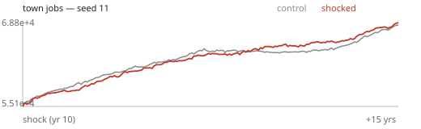
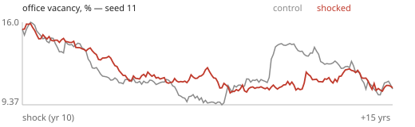
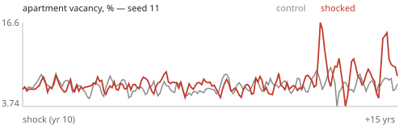

## +30% population over 2 years

An arrivals wave: 1.10% of the register's people a month for 24 months (compounding to +30%), through the arrivals swan's own channel (blackswans.ts `bsMigPull`/`bsArrivals`, landed by households.ts as renter households across the water looking for work, half of them wanting an island flat). Added on top of the swan tick's value each month, because the tick rewrites it at every month's end.

- Twins identical before the shock: yes · landing: households arriving ×3.5 at +1 month; population ×1.0121 at +2 (it reads a month late; one month's wave is ×1.0110) / households arriving ×7.2 at +1 month; population ×1.0124 at +2 (it reads a month late; one month's wave is ×1.0110) / households arriving ×7.0 at +1 month; population ×1.0115 at +2 (it reads a month late; one month's wave is ×1.0110) · holding: population ×1.265 at +2 years (the wave summed; +30% injected), ×1.193 at +5 years / population ×1.264 at +2 years (the wave summed; +30% injected), ×1.163 at +5 years / population ×1.285 at +2 years (the wave summed; +30% injected), ×1.200 at +5 years
- Injector notes: +1.099% of people a month for 24 months on top of the swan's 0.299% (pop 123,151); +1.099% of people a month for 24 months on top of the swan's 0.000% (pop 123,066); +1.099% of people a month for 24 months on top of the swan's 0.000% (pop 120,080)
- Record: Mariel 1980 (+7% of Miami's labour force in months; Card 1990) and the 1990s aliyah (+12% of Israel's population in ~4 years; Friedberg 2001): rents up first (Israel: real rents roughly +10-20% in 1990-92), then home prices, then a building response 1-3 years on; unemployment up briefly, then employment catches up.

| observable | window | effect, median (by seed) | peak | the record says | verdict |
|---|---|---|---|---|---|
| population | impact | +17.6% (+17.6%, +17.5%, +19.0%) | peak +27.2% at 2.1y | ramps to about +30% (years 0-3 mean ~+20%) | **RIGHT** |
| apartment vacancy | impact | +1.2pp (+1.1pp, +1.2pp, +1.6pp) | peak +7.2pp at 6.5y | falls first | **BACKWARDS** |
| apartment effective rent | impact | +26.7% (+22.7%, +27.8%, +26.7%) | peak +51.6% at 2.8y | +15 to +35% (Saiz 2007: ~1% per 1% inflow) | **RIGHT** |
| home prices, years 3-8 | mid | — (—, —, —) | peak +0.0% at 0y | follow the rents up | **NO DATA** |
| apartment starts | impact | +194.0% (+194.0%, —, —) | peak +3894.5% at 2.8y | rise 1-3 years on | **RIGHT** |
| unemployment | impact | +12.1pp (+12.9pp, +11.7pp, +12.1pp) | peak +18.9pp at 2.1y | up briefly (newcomers looking for work) | **WRONG SIZE** |
| jobs, years 3-8 | mid | +7.5% (+7.5%, +8.6%, +6.3%) | peak +9.6% at 8y | firms expand toward the bigger town | **RIGHT** |

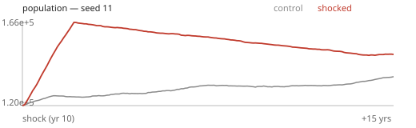
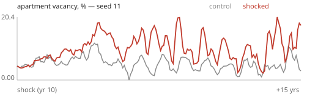
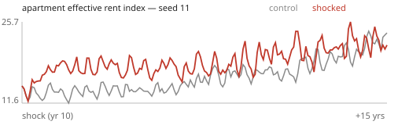

## Remote work: office space per worker −30%

Every office firm's need per head falls 30%, through the engine's own remote-work level (streetRolls.ts `lvlNow`: `econ.spaceLvl` over `econ.spaceLvl0`, the opening's level, divided by 0.7 at the shock). It acts where a firm sizes a lease — renewals, moves, new firms' first leases — and existing leases run to their end; what a sitting firm holds beyond its need is the sublet market's. Held for good (the opening's level is never rewritten).

- Twins identical before the shock: yes · landing: feet a head ×0.700, office firms' need over the feet they hold ×0.704, occupied office ×0.996 at +1 month (leases run to term) / feet a head ×0.700, office firms' need over the feet they hold ×0.701, occupied office ×0.996 at +1 month (leases run to term) / feet a head ×0.700, office firms' need over the feet they hold ×0.703, occupied office ×0.993 at +1 month (leases run to term) · holding: feet a head ×0.700 at +5 years; need over held feet ×0.869 (rises toward 1 as leases roll to the new need) / feet a head ×0.700 at +5 years; need over held feet ×0.837 (rises toward 1 as leases roll to the new need) / feet a head ×0.700 at +5 years; need over held feet ×0.862 (rises toward 1 as leases roll to the new need)
- Injector notes: office spaceLvl0 1.000 → 1.429: need per head ×0.70
- Record: US office 2020-24 (Moody's/CBRE): vacancy ~12% → 19-20% as leases rolled (5-10 year terms), values −30 to −40% (Green Street CPPI office); conversions and teardowns where they pencil.

| observable | window | effect, median (by seed) | peak | the record says | verdict |
|---|---|---|---|---|---|
| office vacancy, years 0-3 | impact | +5.5pp (+6.4pp, +4.5pp, +5.5pp) | peak +14.9pp at 5.4y | rises gradually as leases roll (not overnight): +0.5 to +8pp | **RIGHT** |
| office vacancy, years 3-8 | mid | +12.7pp (+12.7pp, +9.1pp, +12.7pp) | peak +14.9pp at 5.4y | +4 to +20pp as most leases have rolled (US 2020-24: ~+7-8pp, part-rolled) | **RIGHT** |
| office effective rent, years 3-8 | mid | -23.7% (-23.7%, -18.8%, -27.9%) | peak -31.7% at 7.5y | falls 10-50% | **RIGHT** |
| office values, years 3-8 | mid | -41.5% (-51.4%, -41.5%, -39.9%) | peak -68.7% at 6.3y | −20 to −45% (US 2022-24: −30 to −40%) | **RIGHT** |
| office starts, years 3-8 | mid | -97.2% (-100.0%, -88.3%, -97.2%) | peak -1114.7% at 4y | near zero | **RIGHT** |
| office stock, years 8-15 | late | -17.8% (-17.8%, -19.0%, -13.0%) | peak -13.3% at 8y | conversions and teardowns where they pencil | **RIGHT** |

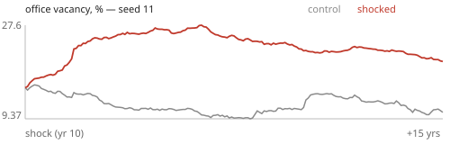
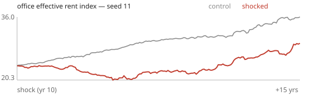
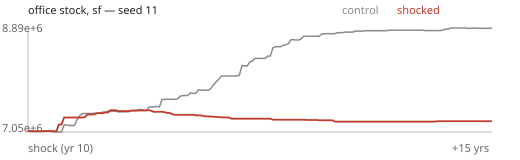

## E-commerce: 20% of shop spending moves online

Households' in-store share of retail spending falls by a fifth: the town's online share (market.ts `econ.online`, read by economy.ts `spendVector`, which moves that share of every shop industry's household dollars to warehousing, IND_ONLINE) is set to the unshocked share plus 20% of the in-store remainder, and held there every month against the engine's own drift (a shadow of the unshocked share is stepped toward the engine's target, recovered from each month's step).

- Twins identical before the shock: yes · landing: in-store share ×0.803, shop industries' sales ×0.834 at +1 month / in-store share ×0.803, shop industries' sales ×0.875 at +1 month / in-store share ×0.803, shop industries' sales ×0.849 at +1 month · holding: in-store share ×0.806 at +5 years / in-store share ×0.806 at +5 years / in-store share ×0.804 at +5 years
- Injector notes: online share 5.0% → 24.0% of shop sales (in-store 95.0% → 76.0%); online share 5.7% → 24.5% of shop sales (in-store 94.3% → 75.5%); online share 2.9% → 22.3% of shop sales (in-store 97.1% → 77.7%)
- Record: US 2010s retail: e-commerce from ~4% to ~11% of retail sales (Census); store closures 2017-20 ran ~9-10k a year; mall vacancy rose ~3-4pp (Moody's REIS) and stayed up where space did not convert; shop rents fell in weak centres.

| observable | window | effect, median (by seed) | peak | the record says | verdict |
|---|---|---|---|---|---|
| shop sales (the shop industries' output) | impact | -18.3% (-18.3%, -15.4%, -18.6%) | peak -26.5% at 7.3y | fall 10-30% (a fifth of the household part) | **RIGHT** |
| floor held by the shops online reaches, years 3-8 | mid | -13.9% (-9.8%, -14.0%, -13.9%) | peak -20.8% at 5.4y | falls toward their sales cut (−3 to −25%) as leases roll | **RIGHT** |
| floor held by other shop-floor firms (backfill), years 3-8 | mid | +2.9% (+5.2%, +2.5%, +2.9%) | peak +6.2% at 5.8y | rises where shop requirements were going unmet | **RIGHT** |
| unhoused shop requirements, years 3-8 | mid | -42.0% (-26.4%, -43.2%, -42.0%) | peak -95.8% at 4.8y | fall as the closed shops' space is taken | **RIGHT** |
| shop vacancy, years 0-3 | impact | +0.7pp (+0.7pp, -0.0pp, +1.2pp) | peak +5.4pp at 4.8y | rises as marginal shops close | **WRONG SIZE** |
| shop vacancy, years 8-15 | late | -3.0pp (-3.0pp, -0.9pp, -4.9pp) | peak +5.4pp at 4.8y | stays up until shops convert | **BACKWARDS** |
| shop effective rent | impact | -2.4% (-3.4%, -0.3%, -2.4%) | peak -12.3% at 7.5y | falls 3-30% | **WRONG SIZE** |
| shop stock, years 8-15 | late | -0.4% (+0.2%, -0.4%, -2.3%) | peak +2.0% at 4.8y | conversions where they pencil | **NO RESPONSE** |

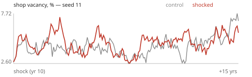
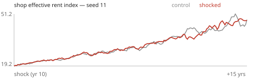
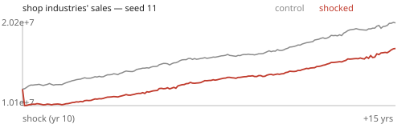

## Placebo: a shock of nothing (the noise floor)

The property-insurance market's price `opexIdx.ins` raised by 0.001 (premium ×1.001) at the snapshot and left alone: no owner, tenant or lender could notice it. It exists to measure how far two twins drift apart from a flipped threshold alone.

- Twins identical before the shock: yes · landing: premium ×1.001000 / premium ×1.001000 / premium ×1.001000
- Injector notes: opexIdx.ins +0.001
- Record: Deterministic chaos in an agent economy: twins diverge from any perturbation once one discrete decision differs (econaudit's lesson). Nothing in the record should move.

| observable | window | effect, median (by seed) | peak | the record says | verdict |
|---|---|---|---|---|---|
| population | impact | -0.1% (-0.4%, -0.1%, -0.1%) | peak -0.8% at 8y | nothing | **RIGHT** |
| jobs | impact | -0.1% (-0.2%, -0.1%, +0.0%) | peak -1.1% at 8y | nothing | **RIGHT** |
| unemployment | impact | -0.0pp (+0.0pp, -0.0pp, -0.2pp) | peak +1.1pp at 7.4y | nothing | **RIGHT** |
| apartment vacancy | impact | +0.1pp (+0.3pp, +0.1pp, -0.1pp) | peak -1.8pp at 5.8y | nothing | **RIGHT** |
| jobs, years 3-8 | mid | -0.2% (-1.2%, -0.2%, +0.1%) | peak -1.1% at 8y | nothing | **SPILLS** |
| office values, market read (val) | impact | +1.2% (+0.8%, +1.2%, +1.3%) | peak +19.8% at 6.3y | nothing: any move is the noise floor | **RIGHT** |
| retail values, market read (val) | impact | +0.4% (+0.4%, +1.4%, -0.6%) | peak +16.6% at 7y | nothing: any move is the noise floor | **RIGHT** |
| industrial values, market read (val) | impact | -2.5% (-2.5%, +1.5%, -5.8%) | peak +59.6% at 5y | nothing: any move is the noise floor | **SPILLS** |
| multifamily values, market read (val) | impact | +0.2% (+0.2%, +0.2%, -1.9%) | peak -33.6% at 8y | nothing: any move is the noise floor | **RIGHT** |
| office values, cap read held (inc), first year | year1 | -0.0% (-0.0%, -0.0%, -0.0%) | peak +14.5% at 7.3y | nothing: any move is the noise floor | **RIGHT** |
| retail values, cap read held (inc), first year | year1 | -0.0% (-0.0%, -0.0%, -0.0%) | peak +16.1% at 7.8y | nothing: any move is the noise floor | **RIGHT** |
| industrial values, cap read held (inc), first year | year1 | -0.0% (-0.0%, -0.0%, -0.0%) | peak +35.2% at 4.5y | nothing: any move is the noise floor | **RIGHT** |
| multifamily values, cap read held (inc), first year | year1 | -0.0% (-0.1%, -0.0%, -0.0%) | peak -26.9% at 8y | nothing: any move is the noise floor | **RIGHT** |
| office values, cap read held (inc) | impact | +0.9% (+1.7%, +0.4%, +0.9%) | peak +14.5% at 7.3y | nothing: any move is the noise floor | **RIGHT** |
| retail values, cap read held (inc) | impact | +0.3% (-0.6%, +0.5%, +0.3%) | peak +16.1% at 7.8y | nothing: any move is the noise floor | **RIGHT** |
| industrial values, cap read held (inc) | impact | -1.1% (-1.1%, +0.4%, -3.7%) | peak +35.2% at 4.5y | nothing: any move is the noise floor | **RIGHT** |
| multifamily values, cap read held (inc) | impact | -0.9% (-0.9%, +0.5%, -1.6%) | peak -26.9% at 8y | nothing: any move is the noise floor | **RIGHT** |
| land, lot panel, first year | year1 | -0.0% (+0.0%, -0.0%, -0.0%) | peak +45.9% at 6y | nothing | **RIGHT** |
| land, lot panel | impact | +0.2% (-1.3%, +0.5%, +0.2%) | peak +45.9% at 6y | nothing | **RIGHT** |
| land value (yearly index) | impact | +0.3% (-4.2%, +0.7%, +0.3%) | peak +36.7% at 6y | nothing | **RIGHT** |
| listings | impact | -1.6% (-0.7%, -1.6%, -5.2%) | peak -53.6% at 7.5y | nothing | **RIGHT** |

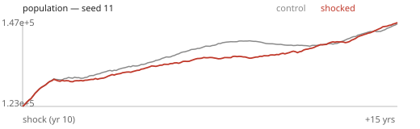
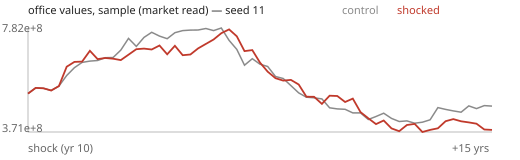
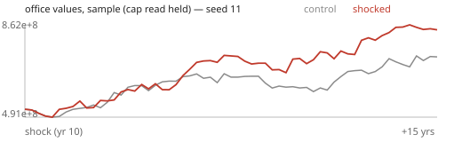

## +50% office stock overnight

Half as much office again, finished and empty, on the town's vacant lots where zoning allows it — best-located lots first, as a boom builds — each at its lot's legal envelope. Unowned, leasing up through the street like any delivery.

- Twins identical before the shock: yes · landing: buildings +53% of the stock, econ.stock ×1.53 at +1 month / buildings +49% of the stock, econ.stock ×1.49 at +1 month / buildings +50% of the stock, econ.stock ×1.50 at +1 month · holding: buildings +34% of the stock at +5 years / buildings +27% of the stock at +5 years / buildings +35% of the stock at +5 years
- Injector notes: 68 buildings, 3.73M sf rentable = 53% of the stock (target 50%); 73 buildings, 3.15M sf rentable = 50% of the stock (target 50%); 80 buildings, 3.40M sf rentable = 50% of the stock (target 50%)
- Record: Houston office 1983-87: vacancy to ~30%, effective rents roughly halved, a decade to absorb (Wheaton & Torto); real rent growth ≈ −2 to −3%/yr per point of vacancy over normal (Wheaton-Torto 1988); starts stop until vacancy recovers; values fall more than rents.

| observable | window | effect, median (by seed) | peak | the record says | verdict |
|---|---|---|---|---|---|
| office vacancy | impact | +26.5pp (+27.1pp, +24.9pp, +26.5pp) | peak +30.1pp at 0.1y | +10 to +35pp (day one is about +30pp) | **RIGHT** |
| office vacancy, years 8-15 | late | +5.8pp (+5.8pp, +1.2pp, +13.5pp) | peak +30.1pp at 0.1y | smaller than the impact: absorbing (0 to +20pp) | **RIGHT** |
| office effective rent | impact | -10.5% (-10.5%, -12.9%, -10.4%) | peak -56.2% at 7.7y | falls 8-50% | **RIGHT** |
| office values (existing buildings) | impact | -34.8% (-35.4%, -34.8%, -34.6%) | peak -82.4% at 5.8y | fall 10-60%, more than rents | **RIGHT** |
| office starts, years 3-8 | mid | -100.0% (-100.0%, -93.3%, -100.0%) | peak -1114.7% at 4y | near zero: −50 to −100% | **RIGHT** |
| office starts, % of the stock a year, years 3-8 | mid | -2.8pp (-3.2pp, -2.8pp, -1.5pp) | peak -30.1pp at 4y | no more than without the glut (≤ 0pp) | **RIGHT** |
| office stock, years 3-8 | mid | +31.9% (+31.9%, +25.3%, +36.0%) | peak +47.9% at 0.1y | the new buildings still stand (+35 to +55%): a glut is absorbed, not torn down — new buildings are rarely demolished | **WRONG SIZE** |
| retail rent (should not move) | impact | -3.5% (-6.2%, +2.0%, -3.5%) | peak -11.0% at 5.3y | within ±5% | **RIGHT** |
| industrial rent (should not move) | impact | +0.2% (+0.4%, -2.2%, +0.2%) | peak -13.7% at 6.2y | within ±5% | **RIGHT** |
| apartments rent (should not move) | impact | +0.2% (-4.2%, +0.2%, +0.3%) | peak -27.9% at 7.4y | within ±5% | **RIGHT** |

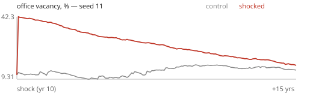
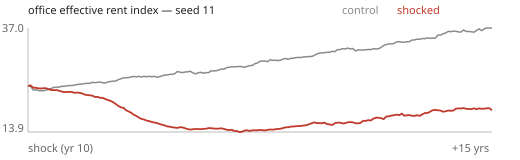
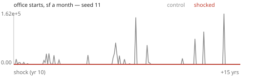

## −20% office stock lost

A fifth of the town's office feet gone overnight (a fire, a wipe-out): buildings spread across the town and its vintages by a hash of their deed, not the player's own. Their tenants mid-lease go looking (streetRolls.ts: a firm is not demolished with its building).

- Twins identical before the shock: yes · landing: buildings −21% of the stock, econ.stock ×0.79 at +1 month / buildings −20% of the stock, econ.stock ×0.80 at +1 month / buildings −20% of the stock, econ.stock ×0.80 at +1 month
- Injector notes: 88 buildings, 1.47M sf rentable lost; 86 buildings, 1.26M sf rentable lost; 93 buildings, 1.37M sf rentable lost
- Record: Scarcity raises rents and cuts vacancy; starts answer 1-3 years after the signal (Wheaton 1999), with overshoot; land in the class's districts rises.

| observable | window | effect, median (by seed) | peak | the record says | verdict |
|---|---|---|---|---|---|
| office vacancy | impact | -9.8pp (-10.0pp, -2.6pp, -9.8pp) | peak -11.6pp at 1.3y | falls 1-12pp (the displaced take the empty space) | **RIGHT** |
| office effective rent | impact | +8.0% (+9.6%, +3.5%, +8.0%) | peak +28.7% at 6.3y | rises 2-30% | **RIGHT** |
| office starts, years 3-8 | mid | +56.5% (+56.5%, +14.6%, +103.9%) | peak -865.3% at 3.4y | rise: a construction answer 1-3 years on | **RIGHT** |

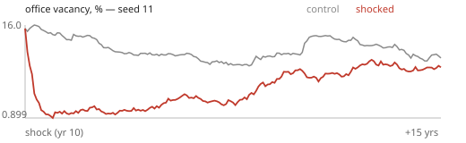
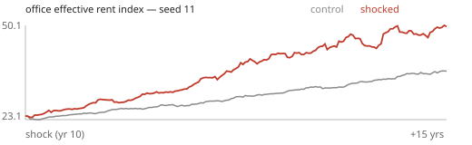
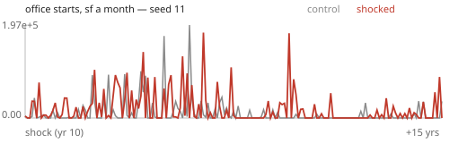

## +50% retail stock overnight

Half as much retail again, finished and empty, on the town's vacant lots where zoning allows it — best-located lots first, as a boom builds — each at its lot's legal envelope. Unowned, leasing up through the street like any delivery.

- Twins identical before the shock: yes · landing: buildings +50% of the stock, econ.stock ×1.50 at +1 month / buildings +49% of the stock, econ.stock ×1.49 at +1 month / buildings +50% of the stock, econ.stock ×1.50 at +1 month · holding: buildings +31% of the stock at +5 years / buildings +35% of the stock at +5 years / buildings +34% of the stock at +5 years
- Injector notes: 121 buildings, 0.99M sf rentable = 50% of the stock (target 50%); 142 buildings, 1.02M sf rentable = 50% of the stock (target 50%); 129 buildings, 1.00M sf rentable = 50% of the stock (target 50%)
- Record: Houston office 1983-87: vacancy to ~30%, effective rents roughly halved, a decade to absorb (Wheaton & Torto); real rent growth ≈ −2 to −3%/yr per point of vacancy over normal (Wheaton-Torto 1988); starts stop until vacancy recovers; values fall more than rents.

| observable | window | effect, median (by seed) | peak | the record says | verdict |
|---|---|---|---|---|---|
| retail vacancy | impact | +17.4pp (+14.8pp, +17.4pp, +21.6pp) | peak +29.5pp at 0.1y | +10 to +35pp (day one is about +30pp) | **RIGHT** |
| retail vacancy, years 8-15 | late | -4.5pp (-5.3pp, -4.5pp, -4.5pp) | peak +29.5pp at 0.1y | smaller than the impact: absorbing (0 to +20pp) | **BACKWARDS** |
| retail effective rent | impact | -6.7% (-6.5%, -9.8%, -6.7%) | peak -31.9% at 7y | falls 8-50% | **WRONG SIZE** |
| retail values (existing buildings) | impact | -22.7% (-22.7%, -37.0%, -20.1%) | peak -46.4% at 6.3y | fall 10-60%, more than rents | **RIGHT** |
| retail starts, years 3-8 | mid | -30.8% (-30.8%, -28.4%, -89.4%) | peak -380.9% at 6y | near zero: −50 to −100% | **WRONG SIZE** |
| retail starts, % of the stock a year, years 3-8 | mid | -1.3pp (-1.3pp, -1.2pp, -2.6pp) | peak -12.8pp at 5.3y | no more than without the glut (≤ 0pp) | **RIGHT** |
| retail stock, years 3-8 | mid | +26.8% (+26.2%, +26.8%, +30.7%) | peak +45.2% at 0.1y | the new buildings still stand (+35 to +55%): a glut is absorbed, not torn down — new buildings are rarely demolished | **WRONG SIZE** |
| office rent (should not move) | impact | +2.9% (+3.0%, +1.6%, +2.9%) | peak +8.6% at 4.5y | within ±5% | **RIGHT** |
| industrial rent (should not move) | impact | +1.5% (+1.5%, +4.8%, +0.4%) | peak +16.8% at 5.3y | within ±5% | **RIGHT** |
| apartments rent (should not move) | impact | +5.4% (+0.4%, +6.7%, +5.4%) | peak +50.6% at 6.1y | within ±5% | **SPILLS** |

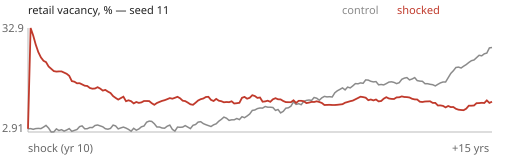
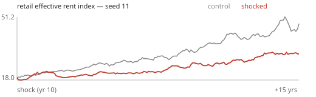
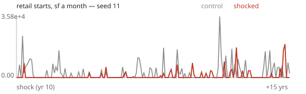

## −20% retail stock lost

A fifth of the town's retail feet gone overnight (a fire, a wipe-out): buildings spread across the town and its vintages by a hash of their deed, not the player's own. Their tenants mid-lease go looking (streetRolls.ts: a firm is not demolished with its building).

- Twins identical before the shock: yes · landing: buildings −20% of the stock, econ.stock ×0.80 at +1 month / buildings −20% of the stock, econ.stock ×0.80 at +1 month / buildings −21% of the stock, econ.stock ×0.79 at +1 month
- Injector notes: 74 buildings, 0.40M sf rentable lost; 70 buildings, 0.41M sf rentable lost; 73 buildings, 0.40M sf rentable lost
- Record: Scarcity raises rents and cuts vacancy; starts answer 1-3 years after the signal (Wheaton 1999), with overshoot; land in the class's districts rises.

| observable | window | effect, median (by seed) | peak | the record says | verdict |
|---|---|---|---|---|---|
| retail vacancy | impact | -1.0pp (-0.3pp, -1.5pp, -1.0pp) | peak +3.6pp at 5.8y | falls 1-12pp (the displaced take the empty space) | **WRONG SIZE** |
| retail effective rent | impact | +2.8% (+1.9%, +6.1%, +2.8%) | peak +14.1% at 6.5y | rises 2-30% | **RIGHT** |
| retail starts, years 3-8 | mid | +23.4% (+23.4%, -44.8%, +28.6%) | peak +488.4% at 0.8y | rise: a construction answer 1-3 years on | **RIGHT** |

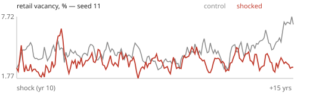
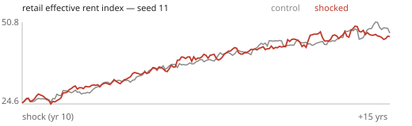
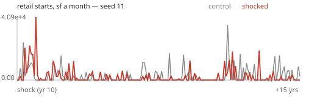

## +50% industrial stock overnight

Half as much industrial again, finished and empty, on the town's vacant lots where zoning allows it — best-located lots first, as a boom builds — each at its lot's legal envelope. Unowned, leasing up through the street like any delivery.

- Twins identical before the shock: yes · landing: buildings +50% of the stock, econ.stock ×1.50 at +1 month / buildings +48% of the stock, econ.stock ×1.48 at +1 month / buildings +50% of the stock, econ.stock ×1.50 at +1 month · holding: buildings +11% of the stock at +5 years / buildings +23% of the stock at +5 years / buildings +38% of the stock at +5 years
- Injector notes: 50 buildings, 0.42M sf rentable = 50% of the stock (target 50%); 69 buildings, 0.48M sf rentable = 51% of the stock (target 50%); 66 buildings, 0.49M sf rentable = 50% of the stock (target 50%)
- Record: Houston office 1983-87: vacancy to ~30%, effective rents roughly halved, a decade to absorb (Wheaton & Torto); real rent growth ≈ −2 to −3%/yr per point of vacancy over normal (Wheaton-Torto 1988); starts stop until vacancy recovers; values fall more than rents.

| observable | window | effect, median (by seed) | peak | the record says | verdict |
|---|---|---|---|---|---|
| industrial vacancy | impact | +26.0pp (+26.0pp, +22.8pp, +28.2pp) | peak +37.0pp at 0.3y | +10 to +35pp (day one is about +30pp) | **RIGHT** |
| industrial vacancy, years 8-15 | late | +2.7pp (-1.0pp, +2.7pp, +7.6pp) | peak +37.0pp at 0.3y | smaller than the impact: absorbing (0 to +20pp) | **RIGHT** |
| industrial effective rent | impact | -13.1% (-20.2%, -11.8%, -13.1%) | peak -64.5% at 6.5y | falls 8-50% | **RIGHT** |
| industrial values (existing buildings) | impact | -17.8% (-33.0%, +44.5%, -17.8%) | peak -52.2% at 5.5y | fall 10-60%, more than rents | **RIGHT** |
| industrial starts, years 3-8 | mid | -100.0% (—, —, -100.0%) | peak -1944.4% at 6.6y | near zero: −50 to −100% | **RIGHT** |
| industrial starts, % of the stock a year, years 3-8 | mid | -1.6pp (-0.2pp, -1.6pp, -2.4pp) | peak -36.9pp at 6.6y | no more than without the glut (≤ 0pp) | **RIGHT** |
| industrial stock, years 3-8 | mid | +18.6% (+12.9%, +18.6%, +31.9%) | peak +47.3% at 0.1y | the new buildings still stand (+35 to +55%): a glut is absorbed, not torn down — new buildings are rarely demolished | **WRONG SIZE** |
| office rent (should not move) | impact | +0.3% (+0.6%, +0.3%, -0.9%) | peak +5.2% at 8y | within ±5% | **RIGHT** |
| retail rent (should not move) | impact | -2.1% (-3.3%, +0.2%, -2.1%) | peak -7.8% at 2.8y | within ±5% | **RIGHT** |
| apartments rent (should not move) | impact | +2.1% (+1.4%, +5.2%, +2.1%) | peak +37.3% at 3.6y | within ±5% | **RIGHT** |

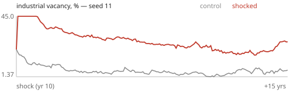
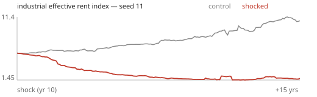

## −20% industrial stock lost

A fifth of the town's industrial feet gone overnight (a fire, a wipe-out): buildings spread across the town and its vintages by a hash of their deed, not the player's own. Their tenants mid-lease go looking (streetRolls.ts: a firm is not demolished with its building).

- Twins identical before the shock: yes · landing: buildings −20% of the stock, econ.stock ×0.80 at +1 month / buildings −21% of the stock, econ.stock ×0.79 at +1 month / buildings −20% of the stock, econ.stock ×0.80 at +1 month
- Injector notes: 18 buildings, 0.17M sf rentable lost; 16 buildings, 0.19M sf rentable lost; 20 buildings, 0.20M sf rentable lost
- Record: Scarcity raises rents and cuts vacancy; starts answer 1-3 years after the signal (Wheaton 1999), with overshoot; land in the class's districts rises.

| observable | window | effect, median (by seed) | peak | the record says | verdict |
|---|---|---|---|---|---|
| industrial vacancy | impact | +0.0pp (+0.0pp, +0.4pp, -3.8pp) | peak -8.5pp at 1.9y | falls 1-12pp (the displaced take the empty space) | **NO RESPONSE** |
| industrial effective rent | impact | +14.3% (-1.7%, +20.0%, +14.3%) | peak +21.5% at 5y | rises 2-30% | **RIGHT** |
| industrial starts, years 3-8 | mid | +76.8% (—, —, +76.8%) | peak -1304.3% at 2.9y | rise: a construction answer 1-3 years on | **RIGHT** |

## +50% apartments stock overnight

Half as much apartments again, finished and empty, on the town's vacant lots where zoning allows it — best-located lots first, as a boom builds — each at its lot's legal envelope. Unowned, leasing up through the street like any delivery.

- Twins identical before the shock: yes · landing: buildings +49% of the stock, econ.stock ×1.49 at +1 month / buildings +51% of the stock, econ.stock ×1.51 at +1 month / buildings +54% of the stock, econ.stock ×1.54 at +1 month · holding: buildings +39% of the stock at +5 years / buildings +42% of the stock at +5 years / buildings +49% of the stock at +5 years
- Injector notes: 19 buildings, 1.51M sf rentable = 51% of the stock (target 50%); 28 buildings, 1.47M sf rentable = 51% of the stock (target 50%); 37 buildings, 1.63M sf rentable = 53% of the stock (target 50%)
- Record: Houston office 1983-87: vacancy to ~30%, effective rents roughly halved, a decade to absorb (Wheaton & Torto); real rent growth ≈ −2 to −3%/yr per point of vacancy over normal (Wheaton-Torto 1988); starts stop until vacancy recovers; values fall more than rents.

| observable | window | effect, median (by seed) | peak | the record says | verdict |
|---|---|---|---|---|---|
| apartments vacancy | impact | +6.9pp (+6.6pp, +6.9pp, +9.9pp) | peak +31.5pp at 0.2y | +10 to +35pp (day one is about +30pp) | **WRONG SIZE** |
| apartments vacancy, years 8-15 | late | +1.0pp (+1.0pp, -1.9pp, +5.2pp) | peak +31.5pp at 0.2y | smaller than the impact: absorbing (0 to +20pp) | **RIGHT** |
| apartments effective rent | impact | -27.7% (-28.9%, -27.7%, -24.8%) | peak -76.6% at 3.8y | falls 8-50% | **RIGHT** |
| apartments values (existing buildings) | impact | -17.6% (-17.5%, -17.6%, -23.1%) | peak -49.9% at 5.3y | fall 10-60%, more than rents | **RIGHT** |
| apartments starts, years 3-8 | mid | -66.1% (-56.5%, -75.7%, —) | peak -2453.8% at 3.3y | near zero: −50 to −100% | **RIGHT** |
| apartments starts, % of the stock a year, years 3-8 | mid | -0.6pp (-0.6pp, -0.4pp, -0.6pp) | peak -28.8pp at 3.3y | no more than without the glut (≤ 0pp) | **RIGHT** |
| apartments stock, years 3-8 | mid | +41.9% (+40.8%, +41.9%, +48.4%) | peak +50.9% at 0.1y | the new buildings still stand (+35 to +55%): a glut is absorbed, not torn down — new buildings are rarely demolished | **RIGHT** |
| office rent (should not move) | impact | -1.8% (-1.8%, +0.1%, -1.8%) | peak -9.5% at 7.1y | within ±5% | **RIGHT** |
| retail rent (should not move) | impact | -3.0% (-3.6%, +0.4%, -3.0%) | peak +8.0% at 6.2y | within ±5% | **RIGHT** |
| industrial rent (should not move) | impact | +3.8% (+3.4%, +5.3%, +3.8%) | peak +15.9% at 5.3y | within ±5% | **RIGHT** |

## −20% apartments stock lost

A fifth of the town's apartments feet gone overnight (a fire, a wipe-out): buildings spread across the town and its vintages by a hash of their deed, not the player's own. Their tenants mid-lease go looking (streetRolls.ts: a firm is not demolished with its building).

- Twins identical before the shock: yes · landing: buildings −20% of the stock, econ.stock ×0.80 at +1 month / buildings −20% of the stock, econ.stock ×0.80 at +1 month / buildings −20% of the stock, econ.stock ×0.80 at +1 month
- Injector notes: 68 buildings, 0.60M sf rentable lost; 65 buildings, 0.58M sf rentable lost; 72 buildings, 0.62M sf rentable lost
- Record: Scarcity raises rents and cuts vacancy; starts answer 1-3 years after the signal (Wheaton 1999), with overshoot; land in the class's districts rises.

| observable | window | effect, median (by seed) | peak | the record says | verdict |
|---|---|---|---|---|---|
| apartments vacancy | impact | -4.9pp (-4.9pp, -4.4pp, -5.0pp) | peak -8.1pp at 4.1y | falls 1-12pp (the displaced take the empty space) | **RIGHT** |
| apartments effective rent | impact | +5.1% (+0.3%, +8.0%, +5.1%) | peak +44.5% at 3.2y | rises 2-30% | **RIGHT** |
| apartments starts, years 3-8 | mid | -18.2% (-28.8%, -7.6%, —) | peak -2453.8% at 3.3y | rise: a construction answer 1-3 years on | **BACKWARDS** |

