# UI clean-up plan

Written 2026-11-10 from a real playthrough on `main` (b029f6d). Plan only: no
code was changed. Screenshots are in [`shots/cleanup/`](shots/cleanup/).

## Summary (one minute)

1. **The interface you play is Classic, not the new shell.** `AGENTS.md` says
   the new shell is the default. It is not: it was shelved on 2026-10-23
   (commit d58757c) and opens only with `?ui=next`. Unreal loads the page
   without that flag (`BWGame.cpp:1046`), so Unreal shows Classic.
2. **The new shell's tables already do what you are asking for.** Same save,
   same data: Classic Portfolio is 551 words and 38 buttons; the new shell's
   Holdings table is 143 words and 10 buttons, with more columns. Recommended
   route: keep the Classic frame, replace its long pages with those tables one
   page at a time. Your call (decision 1).
3. **The clutter is concentrated.** Leasing, Banks, Players, News, Settings and
   the building page carry most of it. Marketplace, Deals, Debt and Portfolio
   are already numbers-first and need trimming, not rebuilding.
4. **Screen space is mismatched to the engine.** Development (10,600 engine
   lines, 14 actions) has no place of its own. Rivals and the macro economy
   (25,000 lines, 1 action between them) have seven of the fifteen rail
   entries. Building operations, the thinnest system, is the first thing on
   the Leasing page.
5. **Three things found on the way.** `pnpm dev` shows a blank page on `main`
   (engine module cycle; the one-file playable works). CI's two browser tests
   only open the shelved shell, so nothing tests the interface players see.
   Loading a save put four pop-up cards on screen, one of them four years old.
6. **Work:** 14 small PRs, text-only and low-risk ones first (section 5).
   Five decisions for you (section 6).

## 1. How this was measured

- Build: the committed one-file playable (`playable/broadway-and-wall.html`,
  built at 976cf81, PR 693; `main` has only a docs commit since).
- Game: new game, $10M, 3-building family book, played 92 months to Sep 2007
  through the store's own actions: 7 buildings, 6 loans, two developments
  delivered, one sale campaign run, one refinance refused, one tenant asking
  for rent relief.
- Size: 1920x1080 with `?host=unreal` (Unreal's `Play.cmd` runs at that size
  and the browser widget fills the window). Checked again at 1366x768 in a
  normal browser: no horizontal scroll, the top bar sheds readouts correctly.
- Prose count: the method from `PLAN.md` section 1. A prose block is a visible
  element of 12 or more words, 70% of them alphabetic. "Sentences" counts
  sentences inside prose blocks.
- Not measured: a vacant lot's build path (my save had no vacant lot left when
  I got there), and anything inside Unreal itself (the `unreal` MCP server was
  not reachable). Both are marked where they matter.

### Classic, page by page

| Page | Words | Prose sentences | In first screen | Buttons | Screens long |
|---|---:|---:|---:|---:|---:|
| City view, nothing open | 1,109 | 12 | 11 | **76** | n/a |
| Portfolio | 551 | 6 | 1 | 38 | 1.8 |
| **Leasing** | 1,100 | **26** | **16** | **120** | 4.0 |
| Deals | 106 | 0 | 0 | 13 | 1.0 |
| The Record | 448 | 13 | 6 | 17 | 2.0 |
| Marketplace | 1,400 | 13 | 2 | 14 | 3.7 |
| Buildings | 1,031 | 2 | 2 | 8 | 2.4 |
| Debt | 450 | 12 | 6 | 42 | 1.8 |
| Investors | 404 | 7 | 2 | 5 | 1.5 |
| **Banks** | **3,388** | 23 | 5 | 20 | **9.8** |
| Books | 417 | 5 | 5 | 16 | 2.2 |
| Markets | 796 | 6 | 5 | 25 | 2.9 |
| Pulse | 221 | 6 | 6 | 7 | 1.0 |
| **Players** | 1,710 | **26** | 14 | 7 | 5.4 |
| **News (Tape)** | 678 | **38** | 23 | 12 | 2.2 |
| Rankings | 407 | 6 | 6 | 7 | 1.6 |
| **Settings** | 682 | **32** | 16 | 32 | 1.8 |
| Primer | 1,427 | 93 | 25 | 7 | 3.0 |
| Building: Overview | 355 | 3 | 3 | 20 | 1.2 |
| Building: Rent roll | 494 | 6 | 4 | 28 | 1.3 |
| Building: Money | 630 | 5 | 0 | 20 | 2.3 |
| Building: Operations | 274 | 2 | 2 | 27 | 1.0 |
| Building: Sell | 349 | 15 | 13 | 19 | 1.2 |
| Building: Convert / Build | 192 | 6 | 6 | 13 | 1.0 |

Your rule is at most one hint per screen. Only Deals passes today.

### The same data in the shelved new shell

| Job | Classic | New shell (`?ui=next`) |
|---|---|---|
| My buildings | Portfolio: 551 words, 38 buttons, 2 lines per row | Holdings: 143 words, 10 buttons, 1 line per row, adds DSCR and WALT |
| My debt | Debt: 450 words, 12 sentences, loans at the bottom | Capital: 158 words, maturities chart then the loan table |
| Leases expiring | Leasing: 1,100 words, 26 sentences, rent roll is the 6th tab | Leasing › Expiring: 126 words, 0 sentences |
| One building | 12 tiles + facts + tabs before any content | 6 figures, three small tables, actions in a footer |
| News | 678 words | 2,801 words (worse) |

The new shell still hosts three Classic pages unchanged (Leasing › Desk,
Capital › Debt desk, Holdings › Returns), so it is not finished either.

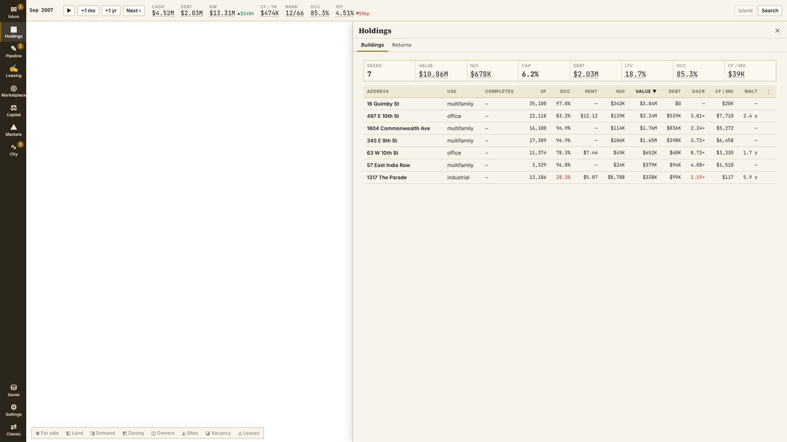
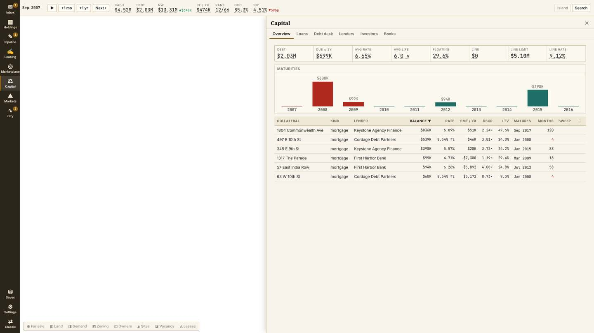

## 2. Engine versus screen

Engine size is lines in `src/engine/` by system; actions are store actions that
change the game. Screen is what Classic gives it.

| System | Engine lines | Player actions | Where it is on screen | Verdict |
|---|---:|---:|---|---|
| Development | 10,641 | 14 | No rail entry. A "Scheme in progress" section inside Portfolio while a job runs, and each building's Convert / Build tab. Budget, contingency used, interest reserve, contractor and pre-leasing are per job in the engine and not on any list. | **Most under-served** |
| Leasing and tenants | 10,398 | 24 | Leasing page, but it opens on house policy and 16 sentences; the rent roll is the 6th tab. Tenant credit, renewal odds, "leaving for" and distress are only inside each building. No lease table across the book. | **Under-served** |
| Debt and lenders | 10,006 | 27 | Debt page is good but leads with the credit line; covenant tests, sweep and prepayment per loan are the last tab. Banks is 9.8 screens of lender financials. | Loans under-served, Banks over-present |
| Property market | 10,690 | 36 | Marketplace, Buildings, Deals, the city card and the offer screen. | Well served; two rail entries for one job |
| Valuation | 5,102 | 0 | Appraisal range and "Why?" on figures. | Right as columns; duplicated on the building page |
| Rivals and owners | 10,799 | 1 | Players (5.4 screens), Rankings, The Record, part of Pulse and Tape. | **Over-present**: 4 rail entries, 1 action |
| Macro economy | 14,639 | 0 | Markets (10 tabs), Pulse, Tape, the cycle chip, a top-bar readout. | Over-present by entry count; the tiles are prose where series belong |
| City and region | 5,818 | 3 | Budget, Policy and Debt are tabs 6-8 of Markets. A zoning-variance slider sits on every building's Overview. | Buried where it matters, intrusive where it does not |
| Investors and funds | 2,983 | 11 | Own rail entry; leads with a reputation table even for a player who has never raised money. | Slightly over-present |
| Operations | ~160 own, rest embedded | 5 | First section of Leasing, a tab on every building, and a "Run" button on every Portfolio row. | **Over-present** |
| Records and taxes | ~1,800 | 1 | The Record, Books, Rankings. | 3 rail entries for reading only |

## 3. Screen by screen

Each line is one change and why. "Hover" means the text moves to a tooltip on
the label it explains.

### Frame: rail, top bar, docket, pop-ups

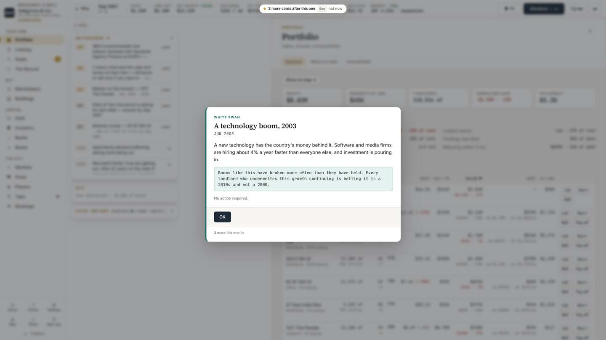

- **Pop-ups:** a card that says "No action required" should not be a modal.
  Send it to the docket and the Tape. On load, drop any card older than the
  current month (this save opened with a 2003 card and a 2005 bids card in
  2007).
- **Rail:** 15 pages and 7 foot buttons. Make it 6 pages with tabs: Portfolio,
  Leasing, Deals, Market, Capital, City. Buildings folds into Market; Banks,
  Investors and Books into Capital; Markets, Tape, Players, Rankings and The
  Record into City. Pulse goes: all of it is on Markets or Tape.
- **Top bar:** 9 readouts. Drop "Avg $ psf" (not a decision number) and fold
  "Line left" into a hover on Cash. Remove the truncated tagline under the firm
  name ("who has never sold a build…").
- **Docket:** "On your desk · 8" mixes 5 items that need an answer with 3 city
  news lines. Keep only items that need an answer; news stays on the Tape.
- **Page header:** every page spends 120px on kicker, title and a one-line
  subtitle ("Value, income, concentration"). Remove the subtitle and kicker.
- **City view at rest:** 76 buttons with nothing open. The 12-button lens bar
  is the largest group; in Unreal the lenses do nothing yet
  (`INVENTORY.md` section 4). Hide lenses that have no effect in the host.

### Portfolio

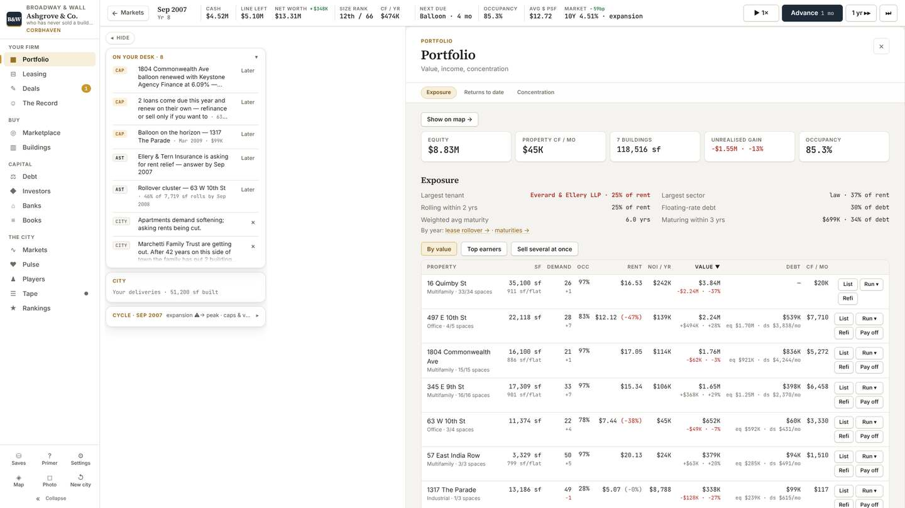

- **Rows:** each row is two lines because of four buttons (List, Run, Refi,
  Pay off). One line per row, one "⋯" menu. Seven buildings then fit in 250px
  instead of 520px.
- **Columns:** add DSCR and WALT (the engine has both; the new shell's table
  shows them). Drop "Demand", which is a location score, not a portfolio number.
- **"Run ▾":** remove from the row. Operations is the thinnest system and does
  not need a button on every line.
- **Exposure block:** keep; it is six numbers and it is good.
- Fine as it is otherwise. This page is not the problem.

### Leasing (largest single fix)

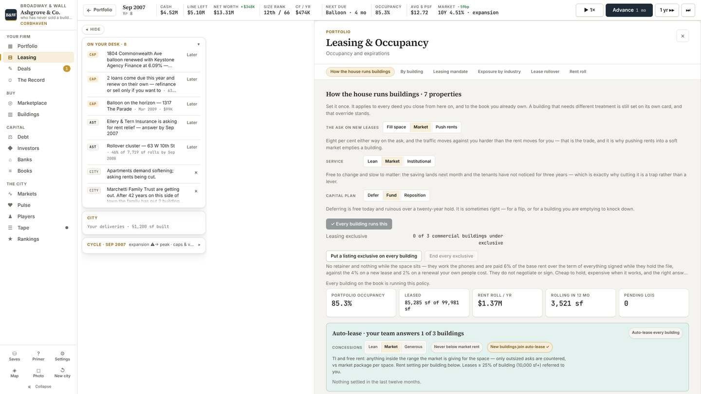

- **Order:** the page opens on "How the house runs buildings": three toggles
  and four paragraphs. The first number is 800px down. Open on the lease table
  instead: every lease on the book, sortable by expiry, rent versus market and
  credit. Tabs become Rent roll, Expiring, Vacant, Letters, Policy.
- **Prose:** all 26 sentences go to hover on the toggle they explain.
- **Policy:** the three toggles and Auto-lease become one compact "Policy" tab
  of toggles with no paragraphs.
- **Buttons:** 120 on the page, most of them per-building policy toggles
  repeated down the list. Show the override only where a building differs from
  the house policy.

### Deals

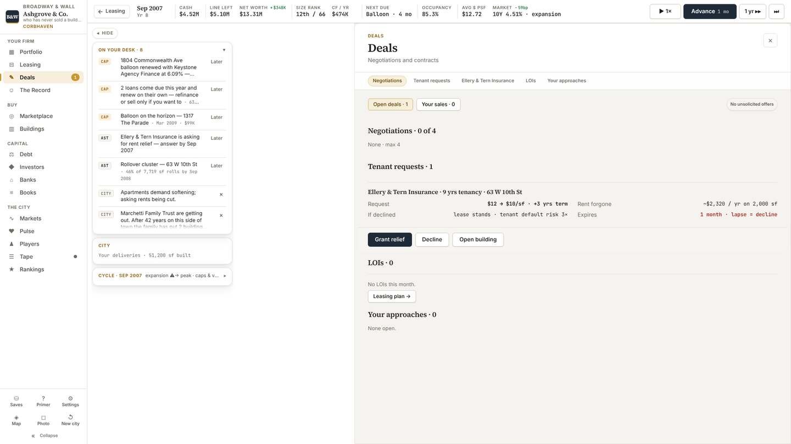

- **This is the model page:** 0 sentences, numbers, three verbs on the item.
- **Add** a "Building" tab listing every job in progress with budget, spent,
  contingency used, completion date and pre-leased share. This gives
  development its place.
- **Empty sections:** "LOIs · 0 — No LOIs this month" and "Your approaches · 0
  — None open" should collapse to nothing when empty.

### Marketplace and Buildings

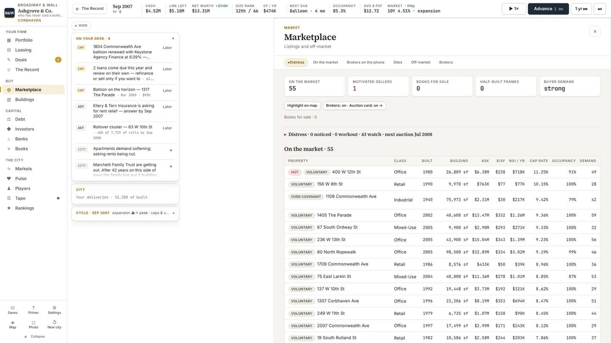

- **Good table.** Keep it.
- **Tag column:** "VOLUNTARY" on 50 of 55 rows is noise. Show a tag only when
  the sale is not ordinary (Hot, Over covenant, Bank-owned).
- **Strip above the table:** "Books for sale · 0", "Half-built frames 0" and
  the collapsed Distress line take 200px to say nothing is there. One line.
- **Essays:** the empty-state paragraphs under Sites and Off-market (41 and 37
  words) become "None".
- **Buildings** becomes a tab of Marketplace ("All buildings").

### Debt, Banks, Investors

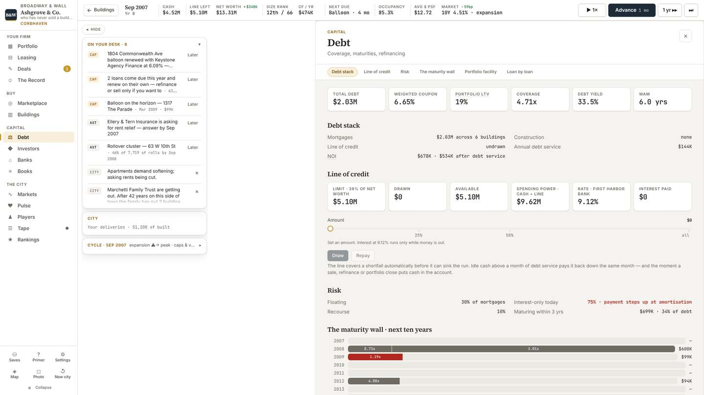
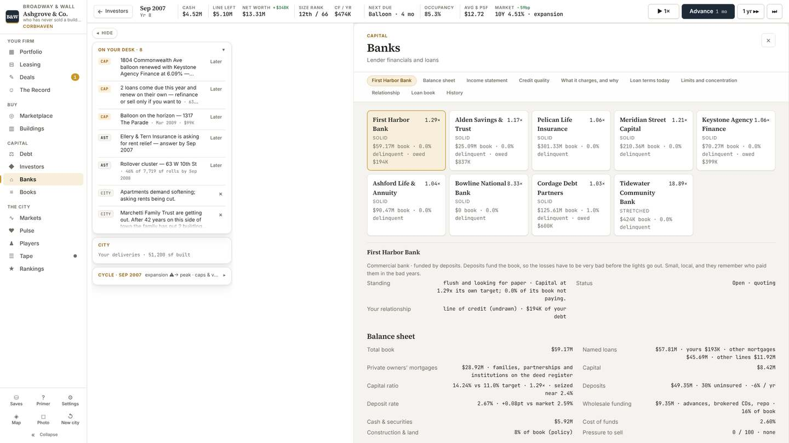
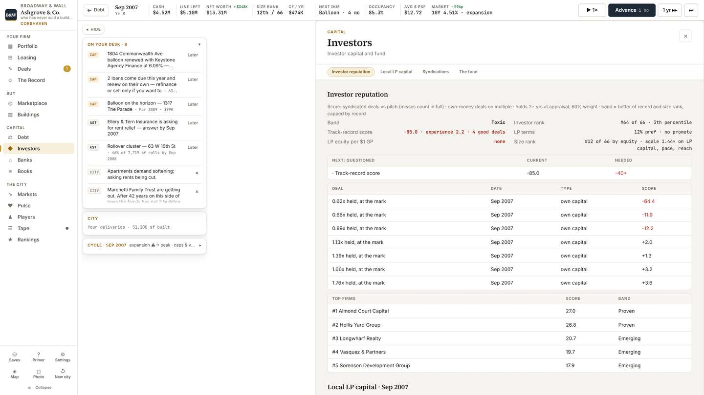

- **Debt order:** put "Loan by loan" first (it is the last tab today) with
  DSCR against the covenant, LTV, maturity, months left, sweep and prepayment
  as columns. Then the maturity wall. The credit line moves below.
- **Debt prose:** the 42-word line-of-credit paragraph and the 51-word colour
  legend go to hover.
- **Banks:** 3,388 words. Lead with one table of lenders: your balance with
  each, their appetite, today's terms. The bank's balance sheet and income
  statement open on click. Nine tiles and nine sections become one table and a
  detail view.
- **Investors:** hide the reputation deal table until the player has raised
  outside money. Rows are named "0.62x held, at the mark"; name the building.
  Fix "3th percentile" (`SyndicateDesk.tsx:39`).

### Markets, Players, News, Rankings, Record

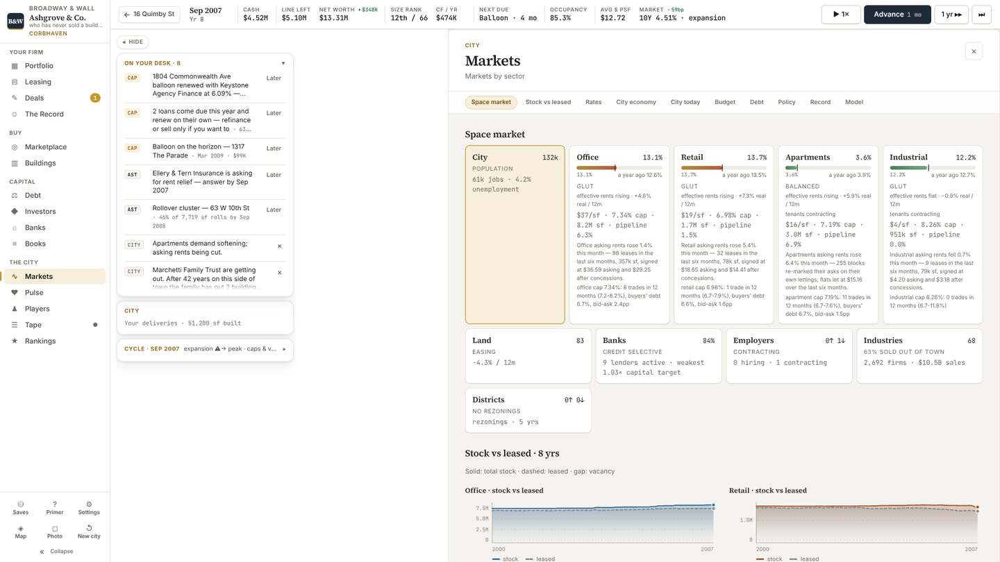
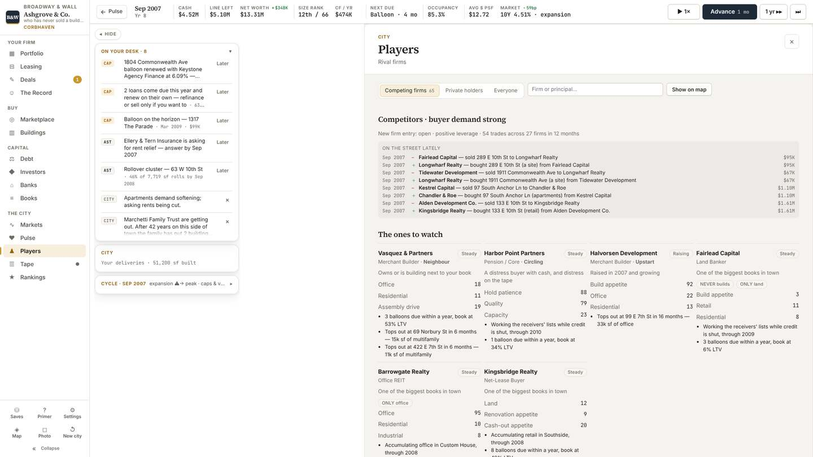
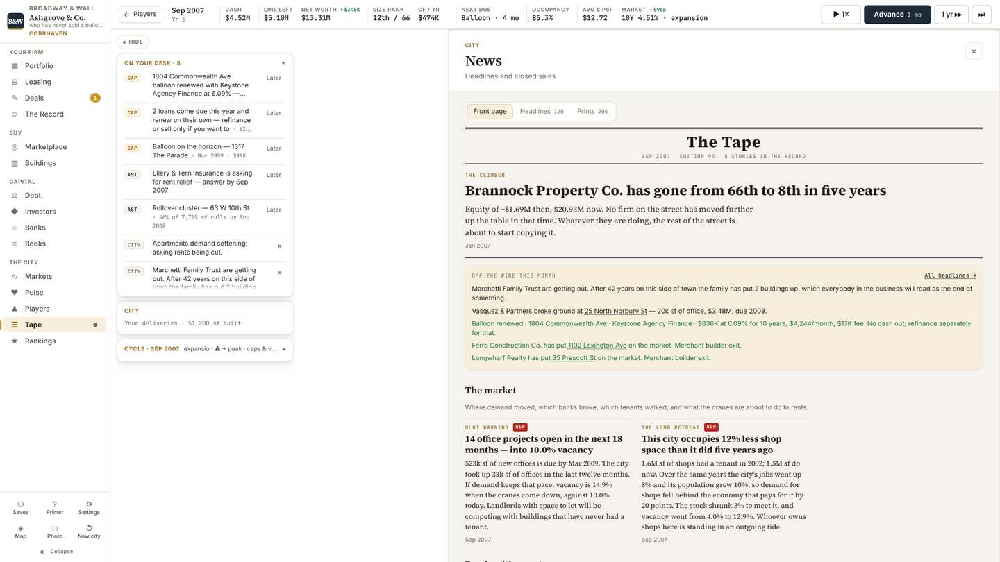

- **Markets tiles:** each sector tile carries about 60 words of generated
  sentences under its numbers. Keep vacancy, rent, cap and pipeline as four
  figures with a sparkline; the sentences go to hover.
- **Markets tabs:** ten tabs. Group as Sectors, Rates, City (economy, budget,
  policy, debt), Record.
- **Players:** opens on eight cards of bullet prose. Open on a table of firms
  (style, assets, debt, LTV, deals this year); the card opens on click. "On the
  street lately" prints every trade twice, once per side: print it once.
- **News:** the front page is a newspaper and reads well, but it is 38
  sentences. Open on Headlines (a list); keep the front page one tab away.
- **Rankings and The Record:** become tabs of City. No content change.

### Building page

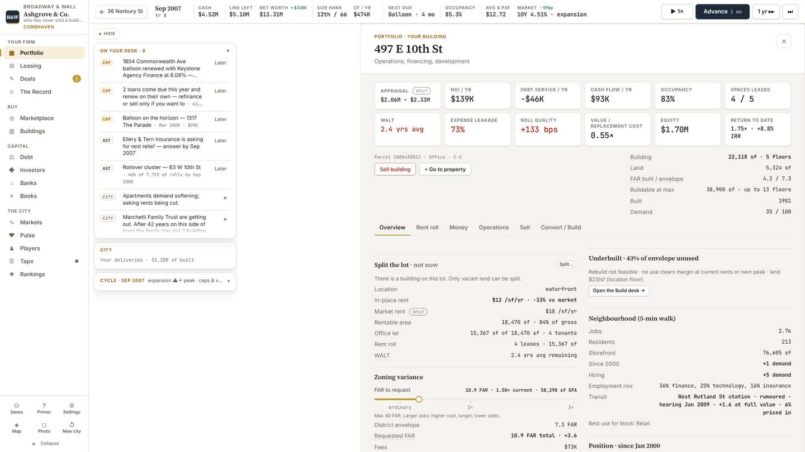
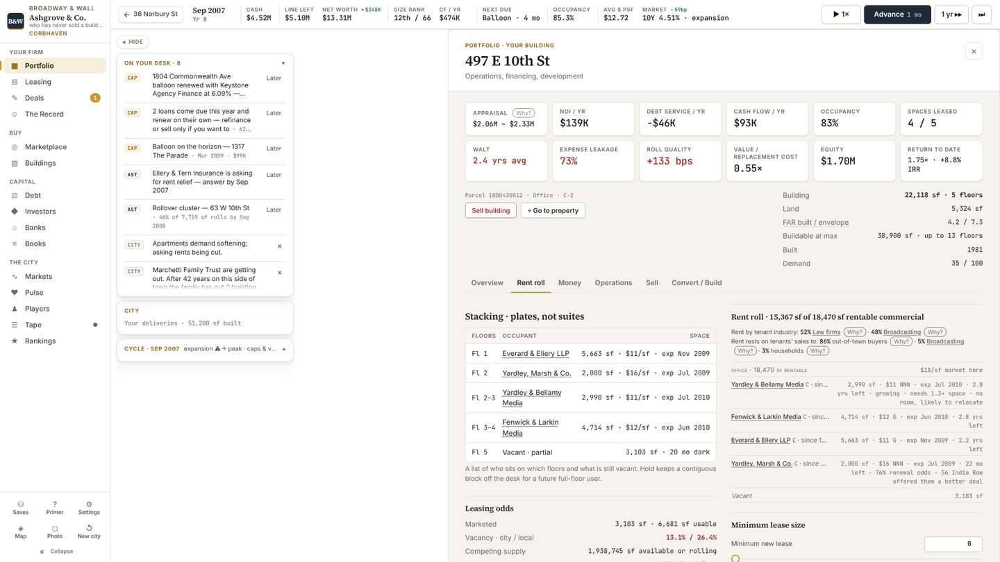

- **Header:** title, 12 tiles, a facts column, two buttons and the tab row take
  560px of 1,080 before any tab content. Cut to 6 tiles (Value, NOI, Occupancy,
  Debt, DSCR, Cash flow) and one facts line.
- **Duplicates:** Occupancy, WALT, Demand, FAR and in-place NOI each appear
  twice on Overview. Show each once.
- **"Split the lot · not now":** the first section on an owned building says
  "There is a building on this lot. Only vacant land can be split." Do not
  show an action that cannot apply.
- **Zoning variance slider:** on Overview for every building. Move it to
  Convert / Build.
- **Rent roll tab:** shows the leases twice, as "Stacking" and as "Rent roll",
  side by side. One table with a floor column.
- **Sell tab:** 15 sentences. Two buttons with fee and time as figures.
- **City card** (the small card when you click a building): repeats the same
  "Split the lot" block and nine jump pills. Keep the six figures and the two
  or three verbs that apply.

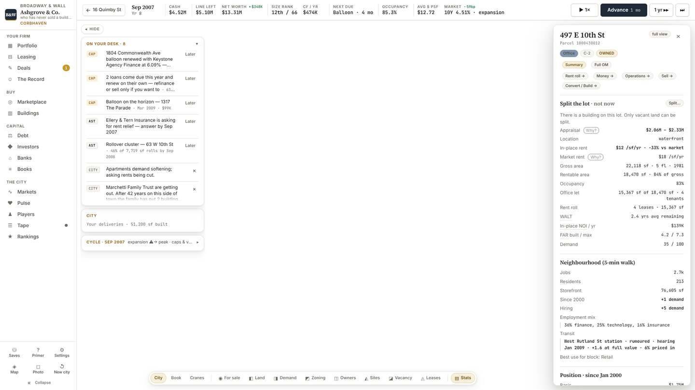

### Offer screen (changed by PR 693, read before touching)

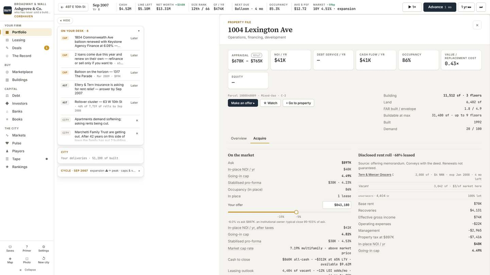

- Read at 976cf81. The left column prints in-place NOI, going-in cap and
  stabilised pro-forma twice (at ask, then at your offer) and the right column
  prints them a third time. Show ask and offer as two columns of one table.
- No other change proposed here until the offer revamp in `TODO.md` is decided.

### Settings

- 32 sentences. Every toggle has a paragraph under it; the longest is 81
  words. Label and toggle only, the paragraph on hover.

### What is fine

Deals, the Marketplace table, the Debt summary tiles, the Portfolio exposure
block and the maturity wall are already what you describe. If the assumption
was that every tab is cluttered, these four show otherwise.

## 4. Navigation

Clicks from the city view with nothing open, counted in the live Classic UI.

| Decision | Clicks today | Path | Should be |
|---|---:|---|---:|
| Buy a listed building at ask | 4, plus closing | Marketplace › row › Make an offer › Pay ask | 3: the row should open on the offer, not Overview |
| Buy from the map | 2, plus closing | click building › Pay ask on the card | fine |
| Refinance | 3 | Portfolio › Refi › Refinance | fine |
| List for sale | 3 | Portfolio › List › Marketed sale | fine |
| Answer a tenant | 2 | Deals › Grant / Decline (or the docket row) | fine |
| Start a development | not measured; `PLAN.md` counted 4-6 | lot › Convert / Build › desk › commit | 3 |
| See every lease expiring this year | 2 plus a scroll | Leasing › Lease rollover tab (5th) | 1 |
| See a loan's covenant headroom | 2 plus a scroll | Debt › Loan by loan (6th tab) | 1 |
| See jobs under construction | 1 plus a scroll, only while one runs | Portfolio › scroll to "Scheme in progress" | 1 |

Acting is already short. The long paths are the reading ones: leases, loan
terms and construction, which are the three deep systems from section 2.

## 5. Work, in order

Each is one small PR to `main`, in `src/ui/` or `src/map/` only unless marked.
Where a new-shell component is named, it exists today in `src/ui/next/` and
reads the same engine functions; nothing recomputes a figure in the UI.

| # | PR | Risk |
|---:|---|---|
| 1 | Remove page subtitles and kickers; move at-rest paragraphs to hover on Leasing, Debt, Settings, Marketplace empty states, Sell tab. Text only. | Lowest |
| 2 | Small fixes: "3th percentile"; investor rows named by building; trades printed once on Players; empty sections collapse; "VOLUNTARY" tag removed. | Lowest |
| 3 | Pop-ups: no modal for "No action required"; drop stale cards on load. | Low |
| 4 | Building page: 6 tiles, no duplicates, no inapplicable "Split the lot", variance slider moved to Convert / Build; same trim on the city card. | Low |
| 5 | Browser test opens Classic as well as `?ui=next` (`test/playable-loads.mjs`), and fails on a pop-up stack at load. | Low |
| 6 | Leasing reorder: lease table first (from `LeasingNext.tsx`), Policy last. | Medium |
| 7 | Debt reorder: loan table and maturities first (from `CapitalNext.tsx`). | Medium |
| 8 | Portfolio: one-line rows, row menu, DSCR and WALT columns (from `HoldingsNext.tsx`). | Medium |
| 9 | Deals › Building tab for jobs in progress (from `PipelineNext.tsx`). | Medium |
| 10 | Rail: 15 pages to 6 with tabs; Pulse removed. | Medium; changes muscle memory |
| 11 | Banks as one lender table with a detail view (from `CapitalMore.tsx`). | Medium |
| 12 | Markets tiles as figures and sparklines; ten tabs to four (from `CityNext.tsx`). | Medium |
| 13 | Players as a firm table; News opens on Headlines. | Medium |
| 14 | Top bar and docket trim; lens bar hides lenses the host cannot draw. | Medium |

After each PR: `tsc`, the smoke check, and the page re-measured with the same
script so the table in section 1 can be updated with before and after.

### Dead weight

- **Dead, delete now:** `rollups/CareerTimeline.tsx` (91 lines, no importers);
  the `InterfaceSwitch` component (nothing renders it); `setUiShell`'s
  `localStorage` write (nothing reads the key); `smoke.mjs` and `verify.mjs`
  (they click a `nav-btn` class that no longer exists; not in CI).
- **Unused inside the shelved shell:** `Shell.tsx` imports ten Classic pages it
  never shows (lines 21-35, 54-73), and `DebtPage.tsx:20-27` re-exports nine
  names nobody imports.
- **Classic is all reachable.** Every file in `src/ui/panels/` is on screen in
  the interface players see. None of it can be deleted today.
- **The big question is the shelved shell:** 8,252 lines in `src/ui/next/` that
  no player can reach. Decision 1 settles whether it is a parts bin (this
  plan), the future default, or deleted.

### Needs an engine change (listed separately, not in this plan's PRs)

- `pnpm dev` is blank on `main`: `engine/dev.ts` reads `RETAIL_FLOORS_MAX` from
  `value.ts` at module level across an import cycle. This is the rule from the
  briefing. The playable bundles in a different order, so CI is green.
- Investor band reads "Toxic, −85" for a firm that has never raised outside
  money, scored on unrealised marks of buildings held under two years. Worth a
  look by whoever owns `reputation.ts`; I have not judged whether it is right.
- The parcel table still says `class: "land"` for lots that have since been
  built on, so any UI filter on it lists built lots as land.

## 6. Decisions for you

1. **Classic or the new shell?** You shelved the new shell on 2026-10-23, and
   its tables are closer to what you are now asking for than Classic is.
   **Recommendation:** keep the Classic frame and move those tables into it,
   page by page (PRs 6-9, 11-12). It matches the "bring the new shell's
   features into Classic" item already in `TODO.md` and each step is small. It
   would help to know what you disliked about the new shell, so it is not
   rebuilt by accident.
2. **Rail down to six entries (PR 10)?** It moves things you know by position.
   **Recommendation:** yes, but after the page fixes, so only one thing changes
   at a time.
3. **News as a list by default?** The newspaper front page is the most written
   screen in the game and may be something you like. **Recommendation:** open
   on Headlines, keep the front page as a tab.
4. **Pulse removed?** Everything on it is on Markets or the Tape.
   **Recommendation:** remove.
5. **Fix `AGENTS.md`?** It tells every agent the new shell is the default.
   **Recommendation:** correct it in PR 1 so the next agent does not audit the
   wrong interface.
